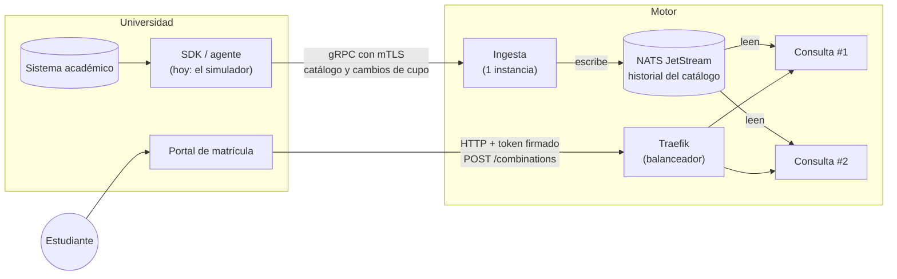

# Scheduling Engine (Java)

Motor de **validación previa de horarios académicos**: calcula por adelantado qué combinaciones de
grupos son compatibles para un estudiante, en lugar de rechazarlo después de que elige. Se usan las
reglas de matrícula del ITM como caso de prueba, pero el motor es agnóstico de institución.

Fuera de alcance: asignación de aulas, carga docente y planeación de la oferta académica.

> **Si es tu primera vez aquí**, lee en este orden: [Qué problema resuelve](#qué-problema-resuelve),
> [Cómo funciona](#cómo-funciona), [Requisitos previos](#requisitos-previos), [Primer arranque](#primer-arranque-paso-a-paso)
> y la [ruta de lectura](#ruta-de-lectura-para-compañeros-nuevos). Las tecnologías (Spring, Docker, gRPC,
> NATS, JWT, Maven…) están explicadas desde cero en [docs/conceptos-base.md](docs/conceptos-base.md).

## Qué problema resuelve

Imagina a Ana, estudiante del ITM. Quiere matricular tres materias: Cálculo, Física y Programación.
Cada materia tiene varios **grupos**, y cada grupo tiene su horario (por ejemplo, "lunes y miércoles de 6 a 8")
y un **cupo** limitado.

En el sistema de matrícula de hoy, Ana elige un grupo de cada materia **a ciegas**. Solo cuando
confirma se entera de que dos de sus grupos chocan en horario, o de que el último cupo de uno ya lo tomó
alguien más. Tiene que volver a empezar, y con miles de estudiantes entrando a la vez al abrir la matrícula,
los grupos buenos se llenan en minutos.

Este motor **le calcula a Ana, antes de que elija, las combinaciones de grupos que sí caben**: sin cruces de
horario y con cupo disponible. Si el grupo que quería se llena, le propone **alternativas que cambian lo
mínimo**. La matrícula en sí sigue haciéndose en el sistema académico de la universidad; el motor solo
recomienda, y si el motor falla, la matrícula sigue funcionando por el camino normal.

Para que esas recomendaciones sean ciertas, el motor necesita saber los cupos **al instante**. Por eso
la universidad le **envía** su catálogo y cada cambio de cupo (el motor nunca le pregunta nada a la
universidad), y el motor responde las consultas de los estudiantes desde una copia en memoria, muy rápido.

## Cómo funciona



Las piezas, en una frase cada una:

| Pieza | Qué hace |
|---|---|
| **Sistema académico** | La base de datos de la universidad: dueña de los grupos y los cupos. El motor nunca la consulta |
| **SDK / agente** | Programa que la universidad instalaría para empujar su catálogo al motor. **Todavía no existe**: hoy su papel lo hace el **simulador** ([sdk.md](docs/sdk.md)) |
| **Ingesta** | La única instancia que recibe esos datos (por [gRPC](docs/conceptos-base.md#grpc-y-protocol-buffers), una conexión cifrada y con certificados en ambos lados, [mTLS](docs/conceptos-base.md#tls-mtls-certificados-ca-y-openssl)), valida su orden y los anota en el historial |
| **NATS JetStream** | El "cuaderno de actas" compartido: guarda en orden la última carga completa del catálogo y los cambios posteriores ([conceptos](docs/conceptos-base.md#nats-y-jetstream)) |
| **Instancias de consulta** | Réplicas del motor que leen ese historial, arman una copia en memoria del catálogo y responden a los estudiantes en milisegundos. Se pueden tener muchas |
| **Traefik** | El balanceador: reparte las solicitudes entre las réplicas listas y las protege con límites ([conceptos](docs/conceptos-base.md#traefik)) |
| **Portal de matrícula** | El sitio web que ve el estudiante. Le pide al motor las combinaciones con un **token firmado** por la universidad, que dice quién es el estudiante y qué cursos puede matricular ([JWT](docs/conceptos-base.md#jwt-y-bearer)) |

Los principios de diseño:

- **La institución empuja toda la información; el motor nunca la consulta**
  ([ADR 0002](docs/adr/0002-roles-de-la-institucion.md)).
- **Catálogo y cupos:** carga completa y luego solo los cambios, numerados con `seq`. El motor mantiene una
  réplica en memoria ([ADR 0003](docs/adr/0003-replica-del-catalogo.md)).
- **Varias instancias:** una de ingesta escribe el historial y todas lo leen
  ([ADR 0005](docs/adr/0005-varias-instancias-con-historial-compartido.md)).
- **Contexto del estudiante:** viaja en cada solicitud dentro de un token firmado
  ([ADR 0004](docs/adr/0004-contexto-del-estudiante-en-token-firmado.md)).

El detalle de los datos y los diagramas de secuencia están en [docs/arquitectura.md](docs/arquitectura.md).

## Requisitos previos

Revisa esto **antes** de clonar y compilar. Todos los comandos se corren desde la raíz del repositorio
(en Windows, usa Git Bash o WSL; `mvnw.cmd` reemplaza a `./mvnw`).

| Requisito | Para qué | Cómo comprobarlo |
|---|---|---|
| **JDK 25** | Compilar el proyecto y correr el simulador y los jars | `java -version` debe decir `25` (y `javac -version` también). Si dice otra versión, instala un JDK 25 (por ejemplo [Temurin](https://adoptium.net/) o [Corretto](https://aws.amazon.com/corretto/)) y apunta `JAVA_HOME` y `PATH` a él |
| **Docker 24 o superior con Compose v2** | Camino completo (NATS, motor y balanceador en contenedores) y pruebas de integración | `docker --version` y `docker compose version` (con espacio, no `docker-compose`) |
| **Docker usable sin `sudo`** (Linux) | Que los comandos del README funcionen tal cual | `docker run --rm hello-world`. Si dice `permission denied`: `sudo usermod -aG docker $USER` y **cierra sesión y vuelve a entrar** |
| **`openssl`** | Lo usa `deploy/setup-dev.sh` para crear certificados y llaves | `openssl version` |
| **`curl`** | Para llamar a la API desde la terminal | `curl --version` |
| **Acceso a Internet** (la primera vez) | Maven descarga las librerías (~330 MB en `~/.m2`) y Docker las imágenes base (`maven`, `eclipse-temurin`, `nats`, `traefik`, `fullstorydev/grpcurl`) | Después de la primera vez se puede trabajar sin conexión |
| **Memoria y CPU** (orientativo) | Compilar y correr el sistema completo (NATS, ingesta, 3 consultas, Traefik) | **8 GB de RAM y 4 núcleos** como mínimo cómodo; unos **10 GB de disco libre**. Con menos, baja las réplicas (`--scale engine=1`) |
| *Opcional:* **Node.js 22.7 o superior** | Solo para las pruebas de la lógica del cliente web (`-Pjs-tests`); sin Node, todo lo demás funciona | `node --version` |
| *Opcional:* **Python 3** | Solo para las gráficas y los datos de la prueba de carga en `bench/` | `python3 --version` |

**No necesitas** instalar Maven (lo descarga `./mvnw`), ni NATS, ni Traefik, ni k6 (corren en contenedores).
Con Docker puedes correr el sistema completo **sin instalar Java**, pero para el paso del token (más abajo) y para
compilar sí hace falta el JDK. En Windows y macOS, algunos comandos de `docs/contrato-institucion.md`
(`--network host`) necesitan un ajuste: está explicado ahí.

## Primer arranque paso a paso

Objetivo: ver el motor calcular combinaciones para un estudiante de ejemplo. Son unos 10 minutos la
primera vez (se descargan y construyen imágenes). Si algo falla, mira
[docs/solucion-de-problemas.md](docs/solucion-de-problemas.md).

**Paso 0. Comprueba que compila y pasa las pruebas** (unos minutos la primera vez):

```sh
./mvnw -B verify
```

Debe terminar con `BUILD SUCCESS`. (Sin Docker, las pruebas que usan NATS se saltan.) Esto deja los jars
en `server/target/sched-server-exec.jar` (el motor) y `simulation/target/sched-simulation.jar` (el simulador).

**Paso 1. Una prueba rápida sin red** (el camino A de [inicio-rapido.md](docs/inicio-rapido.md)):

```sh
java -jar simulation/target/sched-simulation.jar simulate simulation/fixtures/sample.json
```

`simulate` corre el motor en memoria con el solver de línea base (`BacktrackingSolver`), no con el `forward-checking` que usa el
motor por defecto. Deberías ver una tabla con las combinaciones de tres estudiantes de ejemplo (los tiempos varían):

```
escenario: simulation/fixtures/sample.json
estudiante   combinaciones  tiempo (µs)
est-001                  3         5253
est-002                  2          342
est-003                  1          276
```

**Paso 2. El sistema completo con Docker** (el camino B):

```sh
deploy/setup-dev.sh                                                   # 1. secretos de desarrollo: certificados, llaves, contraseña
docker compose -f deploy/docker-compose.yml up -d --build             # 2. NATS, ingesta, 3 consultas y Traefik
docker compose -f deploy/docker-compose.yml ps                        # 3. espera a que todo diga "healthy"
docker compose -f deploy/docker-compose.yml run --rm simulator load   # 4. la universidad simulada carga el catálogo
```

- El paso 1 imprime `==> Certificados`, `==> Llaves del token` y termina sin errores. No se versionan.
- El paso 3 debe mostrar `ingest` y las tres filas de `engine` en `(healthy)` (`nats` y `lb` salen solo como `Up`). Las
  **consultas** (`engine`) tardan **10 a 60 segundos** en pasar de `starting` a `healthy` porque el motor calienta la JVM antes
  de aceptar tráfico ([por qué](docs/conceptos-base.md#jit-y-calentamiento)). Repite el comando hasta que estén las cuatro.
- El paso 4 debe imprimir `catálogo cargado: seq=1 grupos=7`.

**Paso 3. Pide combinaciones como lo haría el portal.** Necesitas un token firmado (el JDK del paso 0):

```sh
TOKEN=$(java -jar simulation/target/sched-simulation.jar token \
  --key deploy/keys/private/dev-1.key --kid dev-1 --student est-001 --courses MAT101,FIS101 \
  --iss institucion-dev --aud sched-engine)

curl -s -X POST localhost:8080/combinations -H "Authorization: Bearer $TOKEN" \
  -H 'content-type: application/json' -d '{}'
```

Debe responder un JSON con `"catalog_seq":1`, `"stale":false` y una lista `schedules` con las
combinaciones (grupos y franjas de cada una). Sin el token, el motor responde `401`.

**Paso 4. Apaga todo:**

```sh
docker compose -f deploy/docker-compose.yml down       # detiene; NATS conserva el historial
docker compose -f deploy/docker-compose.yml down -v    # además borra el historial (empezar de cero)
```

Siguientes pasos: probar un cupo que se agota, escalar a 5 réplicas, abrir el cliente web de demostración
en `/app/` y las métricas: todo en [docs/inicio-rapido.md](docs/inicio-rapido.md). Si prefieres programar
sin Docker para el motor, el camino C (desarrollo local) está en la misma guía.

## Ruta de lectura para compañeros nuevos

**Primero (lo imprescindible, ~1 hora):**

1. Este README, hasta aquí.
2. [docs/conceptos-base.md](docs/conceptos-base.md): no lo leas entero; mira el índice y lee las secciones
   de lo que no conozcas (Java y JIT, Maven, Spring Boot, arquitectura hexagonal, gRPC, JWT, NATS, Docker).
3. [docs/glosario.md](docs/glosario.md): el vocabulario del dominio (grupo, franja, cupo, `seq`, `stale`…).
4. [docs/inicio-rapido.md](docs/inicio-rapido.md): haz el camino A y el B con tus manos.
5. [docs/arquitectura.md](docs/arquitectura.md): cómo encajan las piezas y por dónde leer el código.

**Después (cuando vayas a tocar algo):**

6. [CONTRIBUTING.md](CONTRIBUTING.md): flujo de trabajo, la regla de capas, pruebas y commits.
7. [docs/api-http.md](docs/api-http.md) y [docs/contrato-institucion.md](docs/contrato-institucion.md): los dos contratos (estudiante e institución).
8. El README del módulo que vayas a modificar (ver el [mapa](#mapa-del-repositorio)).
9. [docs/adr/](docs/adr/): léelos en orden; explican **por qué** el motor es como es.
10. [docs/solucion-de-problemas.md](docs/solucion-de-problemas.md): mantenla abierta cuando algo falle.

**Opcional (según tu interés):**

- [docs/simulador.md](docs/simulador.md) y [simulation/experiments/](simulation/experiments/README.md): el experimento estadístico.
- [docs/calidad/](docs/calidad/README.md): el análisis de atributos de calidad (E1 a E5).
- [bench/README.md](bench/README.md): pruebas de carga y de rendimiento.
- [docs/sdk.md](docs/sdk.md): el diseño propuesto del agente de integración.

## Documentación

| Documento | Para qué |
|---|---|
| [Conceptos base](docs/conceptos-base.md) | Las tecnologías explicadas desde cero: qué es, para qué la usamos, dónde está en el repo y cómo verla |
| [Inicio rápido](docs/inicio-rapido.md) | Los tres caminos para correr el motor, la configuración (variables `SCHED_*`) y el calentamiento de la JVM |
| [Arquitectura](docs/arquitectura.md) | Cómo encajan las piezas, seguridad, observabilidad (métricas y logs) y por dónde leer el código |
| [API HTTP](docs/api-http.md) | Autenticación con token, `POST /combinations` y `/alternatives`, códigos de error y sondas `/health` y `/ready` |
| [Contrato con la institución](docs/contrato-institucion.md) | Protocolo gRPC de carga y cambios, y cómo probarlo con grpcurl o grpcui |
| [Simulador](docs/simulador.md) | Comandos del simulador, institución simulada, experimento pareado y análisis estadístico |
| [SDK de integración](docs/sdk.md) | Diseño propuesto (todavía no existe) del agente que conecta cada universidad con el motor |
| [Glosario](docs/glosario.md) | Términos del dominio, del algoritmo, de operación, de tecnologías y de estadística |
| [Solución de problemas](docs/solucion-de-problemas.md) | Errores comunes al compilar, arrancar o desplegar |
| [Decisiones de arquitectura (ADR)](docs/adr/) | Por qué el motor es como es: 0001 hexagonal, 0002 roles, 0003 réplica, 0004 token, 0005 varias instancias, 0006 mejores combinaciones, 0007 SDK, 0008 a 0011 de calidad (propuestos) |
| [Atributos de calidad](docs/calidad/README.md) | Ficha de contexto, supuestos, priorización y los escenarios E1 a E5 |
| [Cómo contribuir](CONTRIBUTING.md) | Flujo de trabajo, regla de capas, pruebas, cobertura, commits y ADRs |
| [Prueba de carga](bench/README.md) | Metodología, resultados y las condiciones en que se midió cada cifra |
| [Experimento pareado: cómo reproducirlo](simulation/experiments/README.md) | Pasos y archivos del experimento estadístico del simulador |

## Mapa del repositorio

Arquitectura hexagonal, con un módulo Maven por capa: las dependencias apuntan hacia adentro y Maven impide
lo contrario ([ADR 0001](docs/adr/0001-arquitectura-hexagonal.md)). Cada carpeta tiene su propio README.

```
domain/                  modelo puro, sin dependencias                                       -> domain/README.md
solver/                  búsqueda de combinaciones (depende de domain)                       -> solver/README.md
application/             casos de uso y puertos (interfaces)                                 -> application/README.md
proto/                   contrato gRPC (src/main/proto) + conversiones                       -> proto/README.md
adapters/                                                                                    -> adapters/README.md
  gateway-http/          Spring MVC: API del estudiante, sondas /health y /ready, cliente web
  grpc-catalog/          grpc-java: carga completa del catálogo desde el SDK
  grpc-events/           grpc-java: cambios incrementales del catálogo
  nats-bus/              jnats: historial compartido en NATS JetStream
  in-memory/             historial en memoria (simulación y pruebas)
server/                  Spring Boot: composición e inyección, calentamiento, métricas       -> server/README.md
simulation/              simulador de escenarios, institución simulada y experimento         -> simulation/README.md
benchmarks/              microbenchmarks con JMH                                             -> benchmarks/README.md
quality/                 reglas de arquitectura (ArchUnit) y cobertura agregada (JaCoCo)     -> quality/README.md
bench/                   prueba de carga con k6, perfiles y resultados                       -> bench/README.md
deploy/                  despliegue local con varias instancias (Docker Compose)             -> deploy/README.md
docs/                    documentación; docs/adr = decisiones de arquitectura
```

## Tecnologías

Cada nombre enlaza a su explicación desde cero en [docs/conceptos-base.md](docs/conceptos-base.md).

| Tecnología | Para qué se usa |
|---|---|
| [Java 25 (LTS)](docs/conceptos-base.md#java-jdk-y-jvm), [JIT](docs/conceptos-base.md#jit-y-calentamiento) | Lenguaje y máquina virtual; el JIT explica el calentamiento antes de `/ready` |
| [Maven y `./mvnw`](docs/conceptos-base.md#maven-y-el-wrapper-mvnw) | Compilación, pruebas y un [módulo](docs/conceptos-base.md#módulos-de-maven) por capa; [jar ejecutable](docs/conceptos-base.md#jar-ejecutable) |
| [Spring Boot 4.1](docs/conceptos-base.md#spring-boot) y [Spring MVC](docs/conceptos-base.md#spring-mvc) | API HTTP del estudiante y composición de la aplicación |
| [Tomcat](docs/conceptos-base.md#tomcat) y [hilos virtuales](docs/conceptos-base.md#hilos-virtuales) | Servidor HTTP embebido y una tarea liviana por solicitud |
| [HTTP, JSON y REST](docs/conceptos-base.md#http-json-y-rest), [Jackson](docs/conceptos-base.md#jackson) | Forma de la API del estudiante |
| [Arquitectura hexagonal](docs/conceptos-base.md#arquitectura-hexagonal-puertos-y-adaptadores) | Núcleo sin frameworks, puertos y adaptadores ([ADR 0001](docs/adr/0001-arquitectura-hexagonal.md)) |
| [gRPC y Protocol Buffers](docs/conceptos-base.md#grpc-y-protocol-buffers) | Contrato con la institución, base del SDK ([ADR 0007](docs/adr/0007-sdk-de-integracion-propio.md)) |
| [TLS, mTLS y OpenSSL](docs/conceptos-base.md#tls-mtls-certificados-ca-y-openssl) | Ingesta cifrada y con autenticación mutua |
| [JWT, Ed25519, `kid` y BouncyCastle](docs/conceptos-base.md#jwt-y-bearer) | Token firmado con el contexto del estudiante ([ADR 0004](docs/adr/0004-contexto-del-estudiante-en-token-firmado.md)) |
| [NATS JetStream](docs/conceptos-base.md#nats-y-jetstream) | Historial compartido del catálogo entre instancias |
| [Docker](docs/conceptos-base.md#docker), [Compose](docs/conceptos-base.md#docker-compose) y [Traefik](docs/conceptos-base.md#traefik) | Imagen única, despliegue con varias instancias y balanceo; [healthcheck](docs/conceptos-base.md#healthcheck) |
| [Kubernetes](docs/conceptos-base.md#kubernetes-solo-como-guía) | Solo como guía de configuración recomendada (no se despliega con él todavía) |
| [Prometheus, Micrometer y Actuator](docs/conceptos-base.md#prometheus-micrometer-y-métricas) | Métricas en un puerto de administración aparte |
| [Logback y formato ECS](docs/conceptos-base.md#logs-y-formato-ecs) | Logs de texto o JSON con id de correlación |
| [JUnit 5](docs/conceptos-base.md#junit-5), [jqwik](docs/conceptos-base.md#pruebas-basadas-en-propiedades-jqwik), [Testcontainers](docs/conceptos-base.md#testcontainers), [ArchUnit](docs/conceptos-base.md#archunit), [JaCoCo](docs/conceptos-base.md#jacoco-y-la-cobertura) | Pruebas, propiedades, integración con NATS real, reglas de arquitectura y cobertura |
| [JMH](docs/conceptos-base.md#jmh), [k6](docs/conceptos-base.md#k6), [async-profiler y JFR](docs/conceptos-base.md#async-profiler-y-jfr), [Python y matplotlib](docs/conceptos-base.md#python-y-matplotlib) | Microbenchmarks, prueba de carga, perfilado y gráficas |
| [GitHub Actions](docs/conceptos-base.md#github-actions-integración-continua) | Integración continua (`./mvnw verify`) |
| [El solver (CSP)](docs/conceptos-base.md#el-problema-del-horario-y-el-solver) | Backtracking, forward checking, MRV y ramificación y poda |
| [Estadística](docs/conceptos-base.md#estadística-del-simulador-a-nivel-intuitivo) y Apache Commons Statistics | Análisis del experimento del simulador |
| [Mermaid](docs/conceptos-base.md#mermaid), [Conventional Commits](docs/conceptos-base.md#conventional-commits), [ADR](docs/conceptos-base.md#adr-decisiones-de-arquitectura) | Convenciones de documentación y de trabajo |

## Seguridad

El motor corre en la infraestructura de la institución y los valores por defecto son los seguros (detalle,
configuración y criterios en [docs/arquitectura.md](docs/arquitectura.md#seguridad)):

- **Ingesta gRPC con mTLS** (`SCHED_GRPC_TLS=required`): sin certificado de servidor, llave y CA de clientes, no arranca.
- **API HTTP con token firmado** (`SCHED_AUTH=jwt`): sin token válido, `401`. `/health` y `/ready` quedan abiertos.
- **NATS con credenciales y TLS** y permisos limitados; **Traefik sin panel** y con límites por IP, de solicitudes simultáneas y de tamaño.
- **Sin datos personales en el motor:** no hay base de datos y los logs nunca incluyen el token.
- **Secretos fuera del repositorio:** `deploy/setup-dev.sh` genera los de desarrollo (ignorados por git).
  `SCHED_AUTH=none` y `SCHED_GRPC_TLS=disabled` existen solo para desarrollo y pruebas, y el motor lo advierte al arrancar.

Qué debe hacer la institución: [contrato](docs/contrato-institucion.md#seguridad-qué-debe-hacer-la-institución).

## Estado actual y pendientes

**Funciona hoy** (todo cubierto por pruebas que corren en `./mvnw verify`):

- Carga completa y cambios incrementales del catálogo por gRPC con mTLS; historial en NATS JetStream y varias instancias de consulta.
- `POST /combinations` y `POST /alternatives` con token JWT EdDSA, preferencias `avoid`, tope de créditos y tiempo máximo de búsqueda.
- Las *k* mejores combinaciones **exactas** con ramificación y poda, con *k* = `SCHED_MAX_COMBINATIONS` (**200 por defecto**; las pruebas de carga usan 5). El único criterio de "mejor" es hoy la penalización de las ventanas `avoid`.
- Calentamiento de la JVM antes de `/ready`, métricas Prometheus en un puerto aparte, logs en JSON con id de correlación.
- Cliente web de demostración en `/app/`, simulador (institución simulada, ráfaga de cupos, experimento estadístico), microbenchmarks y prueba de carga.

**Pendiente:**

- **Filtros y criterios del estudiante** del [ADR 0006](docs/adr/0006-mejores-combinaciones-con-ramificacion-y-poda.md#nota-de-implementación-2026-11-23): jornada, sede, días libres, horas por día, criterios ordenados (huecos, días, cupo) y poner el valor por defecto en 5. La parte exacta con ramificación y poda ya está hecha.
- **SDK de integración**: el agente con consultas configurables que cada universidad instalaría ([ADR 0007](docs/adr/0007-sdk-de-integracion-propio.md), [diseño](docs/sdk.md)). Hoy lo reemplaza el simulador.
- **Avisos de cupo en vivo por WebSocket** y, cuando exista, verificar el mismo token al abrirlo.
- ADR todavía *Propuestos* y sin implementar: [0008](docs/adr/0008-grupos-llenos-en-el-pico-de-matricula.md) (grupos llenos en el pico), [0010](docs/adr/0010-deteccion-de-cambios-en-el-sdk.md) (detección de cambios en el SDK) y [0011](docs/adr/0011-repartir-la-demanda-entre-grupos.md) (repartir la demanda).
- Rotación automática de certificados y un proxy de solo lectura para el socket de Docker de Traefik (ver [arquitectura](docs/arquitectura.md#seguridad)).

## Nota histórica: la comparación con Rust

Este proyecto nació como la versión en Java de una comparación de rendimiento Rust frente a Java del mismo
motor (repositorio [`Scheduling_Engine`](https://github.com/jcagudelo12/Scheduling_Engine)), con la misma
arquitectura, el mismo contrato y las mismas pruebas. El historial de git de este repo conserva los commits
originales de la carpeta `java/`.

**Decisión del equipo: ya no se porta nada a Rust.** El repositorio en Rust queda solo como antecedente y
comparación histórica. Tres herramientas de este repo existen para esa comparación y se conservan como tales
(generan archivos JSON con casos y salidas exactas del motor Java para que otra implementación los verifique;
no forman parte del funcionamiento del motor):

| Herramienta | Qué exporta | Cómo se corre |
|---|---|---|
| `ExportSolverCases` ([`benchmarks`](benchmarks/README.md)) | Problemas del solver y sus resultados exactos | `java -cp benchmarks/target/benchmarks.jar sched.benchmarks.ExportSolverCases salida.json` |
| `ExportJwtVectorsTest` ([`gateway-http`](adapters/gateway-http/README.md)) | Vectores de verificación de tokens | Con `-Dsched.export.jwt-vectors=<ruta>` al correr la prueba |
| `ExportRequestCasesTest` ([`server`](server/README.md)) | Solicitudes HTTP y las respuestas exactas | Con `-Dsched.export.request-cases=<ruta>`; ver el comentario de la clase |
