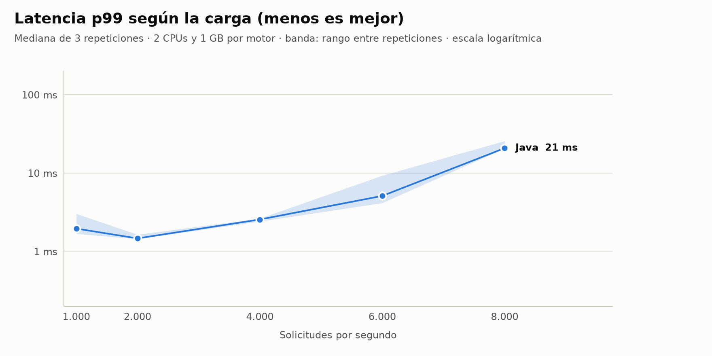

# Prueba de carga

Mide cuántas solicitudes de combinaciones atiende el motor y con qué latencia, en
condiciones controladas y reproducibles.

## Cómo correrla

```sh
python3 -m venv bench/.venv && bench/.venv/bin/pip install -r bench/requirements.txt   # una vez (gráficas)

bench/micro.sh                                          # microbenchmarks con JMH → results/micro.json
bench/run.sh                                            # 3 repeticiones, tasas por defecto
REPS=5 RATES="1000 2000" DURATION=60s bench/run.sh
MAX_COMBINATIONS=50 OUT=bench/results-50 bench/run.sh   # otra variante, en otra carpeta
```

Requiere Docker, Java 25 y Python 3. El script construye la imagen, carga el catálogo con el
simulador de institución y deja el reporte en `results/report.md` y las gráficas en
`results/*.png` (versión clara y oscura).

## Prueba del pico de matrícula (E1, E2 y ADR 0009)

Simula la apertura de una ventana de matrícula, no una tasa constante: la tasa de llegada sube
en rampa hasta el pico, se mantiene (meseta), y baja. Se mide solo la meseta.

```sh
bench/run-pico.sh                                        # 1 réplica a 1.000-8.000/s y 3 réplicas a 4.000-12.000/s
RAMP=30 HOLD=60 DOWN=10 STEPS="1:2000 3:8000" bench/run-pico.sh   # pasos "réplicas:tasa" a elección
MODE=worst bench/run-pico.sh                             # peor caso 7x8 (ver abajo)
MODE=worst SEARCH_TIMEOUT_MS=0 bench/run-pico.sh         # el mismo, sin tiempo máximo (referencia)
python3 bench/report_pico.py bench/results pico 60       # tablas de la corrida (prefijo y segundos de meseta)
```

Requiere lo mismo que `run.sh` (Docker, Java 25, Python 3). Cada paso levanta de cero
`bench/docker-compose.pico.yml` (NATS, la instancia de ingesta, 1 o 3 réplicas de consulta y Traefik
sin los límites por IP del despliegue), carga el catálogo y lanza k6 y la ráfaga de cupos
alineados en el tiempo. Corre sin token ni TLS, igual que `run.sh`.

| Pieza | Qué hace |
|---|---|
| `generate_scenario.py --profile itm` | Catálogo y solicitudes del pico (ver abajo). `run-pico.sh` lo invoca; sin `--profile` el generador sigue produciendo los datos de `run.sh`, idénticos a los de antes |
| `load-pico.js` | k6 con `ramping-arrival-rate`: ~80 % `/combinations` (35 % con `avoid`, 0,5 % perfiles 7x8) y ~20 % `/alternatives` (selección con un grupo lleno, `enrolled`) |
| `seat-storm` (simulador) | Vacía grupos populares a `STORM_RATE` (10 por segundo) durante la meseta, por gRPC, para E1 |
| `report_pico.py` | Resume los JSON de k6, las métricas Prometheus de cada réplica y el uso de CPU |

**Datos del perfil `itm`** (semilla fija): 24 programas x 9 semestres, 5 o 6 asignaturas por semestre
(las de un semestre comparten estudiantes y 2 de los primeros 4 semestres son de servicio, compartidas
entre programas), 1.016 asignaturas y ~3.500 grupos (2 a 6 por asignatura, 8 en las 35 más demandadas),
franjas de 2 h entre 06:00 y 22:00 de lunes a sábado, 10 % de los grupos llenos al inicio, 29.755
estudiantes: 4 o 5 asignaturas en el 70 %, 1-3 en el 7 %, 6-7 en el 18 % y 8 en el 4,5 %. El generador
imprime el cumplimiento del supuesto S5 (69 % de los estudiantes comparten 4 o más materias con su
cohorte, sobre el 60 % exigido) y los porcentajes reales.

**Cómo se mide cada escenario**

| Qué | Cómo |
|---|---|
| E2 (p99 <= 200 ms) | `http_req_duration{phase:hold}` de k6, medido en la meseta, con umbral `p(99)<200` y errores `< 0,1 %` (el 422 por créditos es una respuesta válida y no cuenta como error) |
| `complete=false` (ADR 0009) | Cada respuesta se examina (`"complete":false`): métrica `incomplete` de k6. Se contrasta con `sched_search_incomplete_total` / `sched_search_duration_seconds_count` del motor, que se leen de `/actuator/prometheus` (puerto 8081, red interna) con `docker exec <réplica> curl localhost:8081/actuator/prometheus` |
| E1, % de combinaciones con un grupo lleno (< 2 %) | La ráfaga vacía el grupo `i` de `drain.txt` en `inicio + i / tasa`; k6 conoce esa fórmula y revisa 1 de cada 3 respuestas de `/combinations`: cuenta las combinaciones que incluyen un grupo ya vaciado (`schedule_full`) y cuánto hacía que se había vaciado (`full_group_age_ms`, E1: <= 5 s) |
| E1, retraso del canal | La ráfaga imprime la latencia de confirmación de cada evento (`ack_p50_ms`, `ack_p99_ms`) |

**Peor caso 7x8 (`MODE=worst`).** Solo solicitudes de `worst.json`: 7 asignaturas de las de 8 grupos, con
ventanas `avoid` de jornada. Con `avoid` la búsqueda es exacta (recorre todo el árbol), así que es el caso que
puede agotar `SCHED_SEARCH_TIMEOUT_MS`. Sin ráfaga ni `/alternatives`; tasas más bajas (50, 100 y 200 por
segundo). Con `SEARCH_TIMEOUT_MS=0` se mide la misma carga sin límite, como referencia.

Resultado resumido (2026-11-22): una réplica de 2 CPUs sostiene ~5.000 solicitudes/s con p99 de 3 ms, tres réplicas 8.000/s con p99 de 15 ms (más allá limitan k6 y Traefik de esta máquina); E1 y E2 se cumplen y no hubo respuestas cortadas por el tiempo (0 %), ni en el peor caso 7x8.

Los datos crudos (`bench/results/pico_*`, `worst_*`) están en `.gitignore`: solo se versionan los resúmenes,
en [`results/report-pico.md`](results/report-pico.md).

## Cómo se garantizan condiciones controladas

| Condición | Cómo se controla |
|---|---|
| Mismos datos | Catálogo (5.000 grupos de 1.000 cursos) y 50.000 estudiantes generados con **semilla fija** (`generate_scenario.py`) |
| Mismas solicitudes, en el mismo orden | k6 recorre `students.json` en orden (`iterationInTest`), no elige al azar |
| Mismo punto de partida | Cada repetición arranca desde cero: NATS vacío y el motor recién iniciado |
| Núcleos fijos | El motor corre en las CPUs `4,6`: dos núcleos físicos cuyos hermanos de hiperhilo (5, 7) quedan libres. NATS en `2,3`, k6 en `8-15`. Ajustable con `ENGINE_CPUS`, `NATS_CPUS` y `K6_CPUS` según el procesador |
| Memoria | Límite de 1 GB para el motor |
| CPUs que detecta la JVM | El motor registra al arrancar cuántas CPUs ve (la JVM dimensiona sus hilos con ese número); el script avisa si no coinciden con los núcleos asignados |
| Sin seguridad, a propósito | El motor de la prueba corre con `SCHED_AUTH=none` y `SCHED_GRPC_TLS=disabled` (`bench/docker-compose.yml`) y la carga del catálogo usa `SCHED_INGEST_TLS=disabled`: los resultados miden el motor sin la verificación del token ni TLS. La verificación de una firma Ed25519 agrega costo por solicitud que esta prueba no incluye |
| Sin proxy de puertos | k6 entra por la red interna de Docker (de contenedor a contenedor) |
| Variación | 3 repeticiones; se reporta la **mediana** y el rango del p99 |
| Colas vacías entre tasas | Pausa de 5 s entre una tasa y la siguiente |
| Entorno registrado | Fecha, CPU, kernel, modo de frecuencia, versiones e ID de la imagen, carga del sistema antes de cada repetición |
| Combinaciones por respuesta | Hasta 5 por defecto (`MAX_COMBINATIONS`), lo que verá el estudiante |

Antes de medir: cerrar programas pesados y, si es posible, poner el procesador en modo
`performance` (`sudo cpupower frequency-set -g performance`); el modo usado queda en el reporte.

## Resultados (06-10-2026)

Mediana de 3 repeticiones, motor con 2 CPUs y 1 GB, hasta 5 combinaciones por respuesta,
catálogo de 5.000 grupos. Reporte completo, con el entorno, en [`results/report.md`](results/report.md).

### Arranque y memoria

| | Valor |
|---|---|
| Arranque hasta `/ready` | 4,26 s |
| Memoria en reposo, con el catálogo cargado | 147 MB |
| Memoria máxima bajo carga (8.000/s) | 340 MB |
| Imagen Docker | 591 MB |

### Latencia y capacidad

<picture>
  <source media="(prefers-color-scheme: dark)" srcset="results/latency-p99-dark.png">
  
</picture>

| Solicitudes/s | p50 (ms) | p99 (ms) | p99 mín–máx | CPU (de 200 %) |
|---|---|---|---|---|
| 200 (en frío) | 1,10 | 3,81 | 3,72–4,00 | 48 % |
| 1.000 | 0,48 | 1,96 | 1,68–3,02 | 50 % |
| 2.000 | 0,39 | 1,47 | 1,44–1,64 | 50 % |
| 4.000 | 0,27 | 2,56 | 2,42–2,64 | 68 % |
| 6.000 | 0,25 | 5,11 | 4,16–9,30 | 93 % |
| 8.000 | 0,24 | 21 | 21–26 | 120 % |

<picture>
  <source media="(prefers-color-scheme: dark)" srcset="results/cpu-dark.png">
  
</picture>

Ninguna solicitud falló ni quedó sin atender en ninguna tasa.

### Microbenchmarks (solo el cálculo, sin HTTP)

| | Tiempo promedio |
|---|---|
| Backtracking, 6 cursos × 5 grupos, hasta 500 combinaciones | 50 µs |
| Buscar los grupos de 6 cursos en un catálogo de 5.000 grupos | 0,73 µs |

### Lectura

- **Hasta 4.000 solicitudes por segundo**, el 99 % responde en menos de 3 ms usando un tercio
  de la CPU asignada; a 8.000/s sigue sin descartar solicitudes, pero la cola sube a ~20 ms.
- Como referencia de capacidad: 20.000 estudiantes haciendo 20 consultas en la misma hora
  son ~110 solicitudes/s en promedio, con picos de ~1.100/s. Una instancia de 2 CPUs lo
  cubre con amplio margen; dos instancias dan además tolerancia a fallos.
- Para más carga: más réplicas de consulta detrás de Traefik
  ([ADR 0005](../docs/adr/0005-varias-instancias-con-historial-compartido.md)).

### Comparar los solvers

`SolverComparisonBenchmark` mide `forward-checking` y `backtracking` en el caso de 6 cursos × 5
grupos, en un peor caso sin solución (7 cursos × 8 grupos, el último choca con todo) y en un caso tipo
matrícula (7 cursos × 6 grupos de 2 franjas de 120 min, semilla fija) con 5, 50 y 500 resultados, sin costo
(`enrollment*`) y con costo por madrugar/trasnochar (`enrollmentCost*`):

```bash
./mvnw -q -pl benchmarks -am package -DskipTests
java -jar benchmarks/target/benchmarks.jar SolverComparisonBenchmark
```

### Limitaciones

- El generador de carga corre en la misma máquina que el motor, aunque en núcleos separados.
- El procesador estaba en modo `schedutil` (frecuencia variable), no en `performance`.
- Configuración por defecto de Spring Boot y de la JVM, sin afinar.
