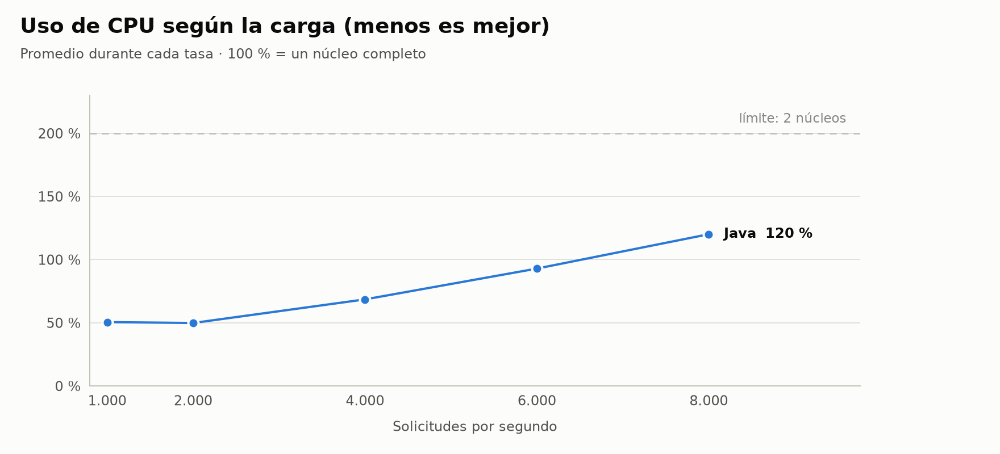

# Prueba de carga

Mide cuántas solicitudes de combinaciones atiende el motor y con qué latencia, en
condiciones controladas y reproducibles.

> **Si es tu primera vez:** *k6* es el programa que genera la carga (miles de solicitudes HTTP por
> segundo), *JMH* mide funciones sueltas del código, *async-profiler* dice en qué métodos gasta
> tiempo el motor y los scripts de Python hacen las tablas y gráficas. Cada uno está explicado en
> [conceptos-base.md](../docs/conceptos-base.md#medición-de-rendimiento). Para correr el motor,
> no necesitas nada de esta carpeta.

## Qué necesitas

| Herramienta | Para qué | Cómo instalarla |
|---|---|---|
| Docker 24+ con Compose v2 | Levantar el motor, NATS y Traefik, y correr k6 en un contenedor | [Instalar Docker](https://docs.docker.com/engine/install/). Sin `sudo` (ver el [README](../README.md#requisitos-previos)) |
| Java 25 | Compilar y correr el motor y los microbenchmarks | `java -version` |
| Python 3 (probado con 3.14) | Generar los datos y las gráficas | `python3 -m venv bench/.venv && bench/.venv/bin/pip install -r bench/requirements.txt` instala `matplotlib` (gráficas) y `cryptography` (firma los tokens de `profile-tokens.py`) |
| k6 | Ya viene en un contenedor (`grafana/k6`): no hace falta instalarlo | |
| async-profiler 4.x | Solo para `profile-server.sh` y `overflow-run.sh` con `COLD_PROF=1` | Ver [Instalar async-profiler](#instalar-async-profiler) |
| Linux con `taskset` | Fijar el motor a núcleos concretos (`bench/*.sh` fuera de Docker) | Viene en el paquete `util-linux`. En macOS y Windows no existe: las corridas con núcleos fijos solo se hacen en Linux |

### Instalar async-profiler

[async-profiler](https://github.com/async-profiler/async-profiler) es un perfilador de bajo costo
para la JVM. Los scripts lo buscan en `$ASPROF_DIR/bin/asprof` y `$ASPROF_DIR/bin/jfrconv`
(por defecto `/usr/lib/jvm/java-25-amazon-corretto`).

- **Con Amazon Corretto 25** ya viene incluido en la carpeta `bin/` del JDK: no hay que instalar
  nada. Comprueba con `ls $JAVA_HOME/bin/asprof`.
- **Con otro JDK**: descarga el `.tar.gz` de la versión 4.x desde sus
  [releases](https://github.com/async-profiler/async-profiler/releases), descomprímelo y apunta
  `ASPROF_DIR` a esa carpeta (debe tener `bin/asprof` y `bin/jfrconv`):
  `ASPROF_DIR=$HOME/async-profiler-4.5-linux-x64 bench/profile-server.sh`.
- Si `cat /proc/sys/kernel/perf_event_paranoid` da más de 1, el perfilador no puede usar los
  contadores del procesador: usa `-e ctimer` (un temporizador por hilo, sin permisos especiales),
  que es lo que se usó en [`profile-server.md`](results/profile-server.md).

### Ajustar los núcleos a tu máquina

Para que los resultados sean comparables, cada pieza corre en núcleos fijos (`taskset` o
`--cpuset-cpus`). Los valores por defecto son los de un Ryzen 7 2700 (16 hilos) y **no sirven tal cual
en otra máquina**: si tu procesador tiene menos hilos, los scripts fallarán o compartirán núcleos.
Cámbialos con variables de entorno:

| Variable | Por defecto | Qué fija |
|---|---|---|
| `ENGINE_CPUS` | `4,6` | Núcleos del motor (la JVM los ve como 2 CPUs) |
| `NATS_CPUS` | `2,3` en `run.sh`; `5,7` en el resto | Núcleos de NATS (y de la ingesta en el pico) |
| `K6_CPUS` | `8-15` | Núcleos del generador de carga |

Pasos: (1) mira tus hilos con `lscpu -e` o `nproc`; (2) en procesadores con hiperhilos, cada núcleo
físico aparece como dos números (`lscpu -e` los agrupa en la columna `CORE`): para el motor elige un
solo hilo de cada núcleo físico y deja libres sus hermanos; (3) reparte sin solaparlos, por ejemplo
en una máquina de 8 hilos: `ENGINE_CPUS=2,3 NATS_CPUS=1 K6_CPUS=4-7 bench/run.sh`. Si no tienes
núcleos de sobra, los números sirven para comparar entre sí corridas de tu propia máquina, no con los
de este reporte.

## Cómo correrla

```sh
python3 -m venv bench/.venv && bench/.venv/bin/pip install -r bench/requirements.txt   # una vez (gráficas)

bench/micro.sh                                          # microbenchmarks con JMH → results/micro.json
bench/run.sh                                            # 3 repeticiones, tasas por defecto
REPS=5 RATES="1000 2000" DURATION=60s bench/run.sh
MAX_COMBINATIONS=50 OUT=bench/results-50 bench/run.sh   # otra variante, en otra carpeta
```

Requiere Docker, Java 25 y Python 3 (ver [Qué necesitas](#qué-necesitas)). El script construye la imagen, carga el catálogo con el
simulador de institución y deja el reporte en `results/report.md` y las gráficas en
`results/*.png` (versión clara y oscura).

## Arranque en frío con y sin calentamiento

```sh
RATE=3500 REPS=3 WORK=/tmp/warmup-3500 bench/warmup-compare.sh   # SCHED_WARMUP=off contra on, alternadas; ver results/warmup.md
```

El motor calienta la JVM antes de responder `200` en `/ready` (`SCHED_WARMUP=on`, por defecto). Por eso `bench/docker-compose.pico.yml` ya arranca las réplicas calientes
(su `healthcheck` espera a `/ready`; `SCHED_WARMUP=off bench/run-pico.sh` reproduce el arranque en frío de `results/report-pico.md`) y `bench/docker-compose.yml`
(`run.sh`, que mide también las primeras solicitudes en frío) lo deja apagado. Resultados y método: [`results/warmup.md`](results/warmup.md).

## Prueba del pico de matrícula (E1, E2 y ADR 0009)

Mide los escenarios [E1](../docs/calidad/04-escenarios.md#e1-un-grupo-recomendado-se-llena-durante-el-pico)
(un grupo se llena durante el pico) y [E2](../docs/calidad/04-escenarios.md#e2-una-búsqueda-que-explota)
(latencia acotada) de la carpeta de calidad. Simula la apertura de una ventana de matrícula, no una tasa constante: la tasa de llegada sube
en rampa hasta el pico, se mantiene (meseta), y baja. Se mide solo la meseta.

```sh
bench/run-pico.sh                                        # 1 réplica a 1.000-8.000/s y 3 réplicas a 4.000-12.000/s
RAMP=30 HOLD=60 DOWN=10 STEPS="1:2000 3:8000" bench/run-pico.sh   # pasos "réplicas:tasa" a elección
MODE=worst bench/run-pico.sh                             # peor caso 7x8 (ver abajo)
MODE=worst SEARCH_TIMEOUT_MS=0 bench/run-pico.sh         # el mismo, sin tiempo máximo (referencia)
python3 bench/report_pico.py bench/results pico 60       # tablas de la corrida (prefijo y segundos de meseta)
```

Requiere lo mismo que `run.sh` (Docker, Java 25, Python 3). Cada paso levanta de cero
`bench/docker-compose.pico.yml` (NATS, la instancia de ingesta, 1 o 3 réplicas de consulta y Traefik
sin los límites por IP del despliegue), carga el catálogo y lanza k6 y la ráfaga de cupos
alineados en el tiempo. Corre sin token ni TLS, igual que `run.sh`.

| Pieza | Qué hace |
|---|---|
| `generate_scenario.py --profile itm` | Catálogo y solicitudes del pico (ver abajo). `run-pico.sh` lo invoca; sin `--profile` el generador sigue produciendo los datos de `run.sh`, idénticos a los de antes |
| `load-pico.js` | k6 con `ramping-arrival-rate`: ~80 % `/combinations` (35 % con `avoid`, 0,5 % perfiles 7x8) y ~20 % `/alternatives` (selección con un grupo lleno, `enrolled`) |
| `seat-storm` (simulador) | Vacía grupos populares a `STORM_RATE` (10 por segundo) durante la meseta, por gRPC, para E1 |
| `report_pico.py` | Resume los JSON de k6, las métricas Prometheus de cada réplica y el uso de CPU |
| `profile-server.sh`, `profile-tokens.py`, `profile-breakdown.py` | Perfil del motor con async-profiler (CPU, asignación, espera) bajo la mezcla del pico, con `AUTH=none` o `AUTH=jwt`; ver [`results/profile-server.md`](results/profile-server.md) |
| `overflow-run.sh`, `overflow-summary.py`, `LatencyProbe.java` | Una corrida con medición (CPU por hilo, latencia por tramos de 10 s, descartadas y VUs de k6, sonda independiente, JFR, perfil del arranque en frío) y parámetros para los experimentos de JVM, núcleos y hilos; ver "Por qué se desborda la latencia con token" en [`results/profile-server.md`](results/profile-server.md) |

**Datos del perfil `itm`** (semilla fija): 24 programas x 9 semestres, 5 o 6 asignaturas por semestre
(las de un semestre comparten estudiantes y 2 de los primeros 4 semestres son de servicio, compartidas
entre programas), 1.016 asignaturas y ~3.500 grupos (2 a 6 por asignatura, 8 en las 35 más demandadas),
franjas de 2 h entre 06:00 y 22:00 de lunes a sábado, 10 % de los grupos llenos al inicio, 29.755
estudiantes: 4 o 5 asignaturas en el 70 %, 1-3 en el 7 %, 6-7 en el 18 % y 8 en el 4,5 %. El generador
imprime el cumplimiento del supuesto S5 (69 % de los estudiantes comparten 4 o más materias con su
cohorte, sobre el 60 % exigido) y los porcentajes reales.

**Cómo se mide cada escenario**

| Qué | Cómo |
|---|---|
| E2 (p99 <= 200 ms) | `http_req_duration{phase:hold}` de k6, medido en la meseta, con umbral `p(99)<200` y errores `< 0,1 %` (el 422 por créditos es una respuesta válida y no cuenta como error) |
| `complete=false` (ADR 0009) | Cada respuesta se examina (`"complete":false`): métrica `incomplete` de k6. Se contrasta con `sched_search_incomplete_total` / `sched_search_duration_seconds_count` del motor, que se leen de `/actuator/prometheus` (puerto 8081, red interna) con `docker exec <réplica> curl localhost:8081/actuator/prometheus` |
| E1, % de combinaciones con un grupo lleno (< 2 %) | La ráfaga vacía el grupo `i` de `drain.txt` en `inicio + i / tasa`; k6 conoce esa fórmula y revisa 1 de cada 3 respuestas de `/combinations`: cuenta las combinaciones que incluyen un grupo ya vaciado (`schedule_full`) y cuánto hacía que se había vaciado (`full_group_age_ms`, E1: <= 5 s) |
| E1, retraso del canal | La ráfaga imprime la latencia de confirmación de cada evento (`ack_p50_ms`, `ack_p99_ms`) |

**Peor caso 7x8 (`MODE=worst`).** Solo solicitudes de `worst.json`: 7 asignaturas de las de 8 grupos, con
ventanas `avoid` de jornada. Con `avoid` la búsqueda es exacta (recorre todo el árbol), así que es el caso que
puede agotar `SCHED_SEARCH_TIMEOUT_MS`. Sin ráfaga ni `/alternatives`; tasas más bajas (50, 100 y 200 por
segundo). Con `SEARCH_TIMEOUT_MS=0` se mide la misma carga sin límite, como referencia.

Resultado resumido (2026-11-22, **sin token y con la JVM fría**, perfil `itm`, 5 combinaciones): una réplica de 2 CPUs sostiene ~5.000 solicitudes/s con p99 de 3 ms, tres réplicas 8.000/s con p99 de 15 ms (más allá limitan k6 y Traefik de esta máquina); E1 y E2 se cumplen y no hubo respuestas cortadas por el tiempo (0 %), ni en el peor caso 7x8.

Los datos crudos (`bench/results/pico_*`, `worst_*`) están en `.gitignore`: solo se versionan los resúmenes,
en [`results/report-pico.md`](results/report-pico.md).

## Seguir una prueba en vivo

Mientras corre una prueba de carga puedes verla desde el navegador, con dos herramientas que se
activan con una variable y que **por defecto están apagadas** (sin ellas los scripts hacen exactamente lo
de siempre). Qué es cada una: [Grafana](../docs/conceptos-base.md#grafana),
[cAdvisor](../docs/conceptos-base.md#cadvisor) y [panel web de k6](../docs/conceptos-base.md#panel-web-de-k6).

| Variable | Qué activa | Dónde mirar |
|---|---|---|
| `OBSERVE=1` | Prometheus, Grafana y cAdvisor junto al compose del pico (`docker-compose.observe.yml`), con el mismo tablero "Motor de horarios" de `deploy/`. Solo en `run-pico.sh` | <http://127.0.0.1:3000>, usuario `admin` |
| `K6_DASHBOARD=1` | El panel web de k6 (lo que mide el generador de carga) y, al terminar, su reporte HTML. En `run-pico.sh` y `run.sh` | <http://127.0.0.1:5665> |

```sh
OBSERVE=1 K6_DASHBOARD=1 bench/run-pico.sh                        # las dos cosas, con los pasos por defecto
OBSERVE=1 K6_DASHBOARD=1 STEPS="1:2000" bench/run-pico.sh         # un solo paso: más fácil de seguir
K6_DASHBOARD=1 bench/run.sh                                       # solo el panel de k6 en la prueba simple
```

Cómo seguirla:

1. Lanza el comando. Al empezar, el script imprime la dirección de Grafana y, en cada paso, la del panel de k6.
2. **Abre Grafana** (<http://127.0.0.1:3000>). La contraseña es `GRAFANA_ADMIN_PASSWORD` de `deploy/.env` (la crea
   `deploy/setup-dev.sh`); si no existe ese archivo, el script genera una solo para esa corrida y la imprime.
   El tablero se abre solo, con refresco de 5 s. Las réplicas aparecen como `engine1`, `engine2`, `engine3`.
3. **Abre el panel de k6** (<http://127.0.0.1:5665>): solo existe mientras k6 corre (arranca unos segundos
   después del comando, cuando el motor ya está listo). Si lo abres antes, recarga.
4. Qué mirar: la rampa en **Tráfico**, la **latencia p99 frente a la línea de 200 ms**, la **CPU de cada
   contenedor** (el motor sube hasta su tope de 2 núcleos cuando se satura) y, en **Catálogo**, los eventos de la
   ráfaga de cupos. Cada panel trae una descripción de qué significa y qué valor es bueno.
5. **Cada paso levanta todo de cero** (también Prometheus y Grafana): al cambiar de paso el tablero se queda sin
   datos unos segundos y la gráfica empieza de nuevo. Al terminar el script, Grafana se apaga con el resto.

**El reporte HTML de k6** queda en `bench/results/<prefijo>_r<réplicas>_t<tasa>_k6_dashboard.html`
(`run.sh`: `java_rep<n>_r<tasa>_k6_dashboard.html`, uno por tasa y repetición). Es un solo archivo: ábrelo con el navegador, sin
servidor. Está en `.gitignore` (no se versiona).

Variables de ajuste (todas opcionales):

| Variable | Por defecto | Para qué |
|---|---|---|
| `OBSERVE_CPUS` | `2,3` | Núcleos de Prometheus, Grafana y cAdvisor |
| `GRAFANA_PORT`, `PROMETHEUS_PORT` | `3000`, `9090` | Puerto en `127.0.0.1` si el tuyo ya está ocupado |
| `K6_DASHBOARD_PORT` | `5665` | Puerto del panel de k6 en `127.0.0.1` |

**Observar consume CPU, y eso puede alterar la medición.** Con la distribución de núcleos por defecto los 16 hilos
de la máquina de referencia ya están asignados (Traefik `0-3`, motores, NATS y k6 el resto): Grafana, Prometheus y
cAdvisor van fijados a `OBSERVE_CPUS` (`2,3`), que **no son núcleos de ningún motor ni de k6**, pero sí de Traefik, y cAdvisor mide cada
5 s todos los contenedores. El panel web de k6 también gasta algo en los núcleos de k6. Por eso **una corrida con `OBSERVE=1` o
`K6_DASHBOARD=1` sirve para entender y depurar, no para citar cifras**: las cifras oficiales ([resultados](#resultados-2026-10-06),
[`report-pico.md`](results/report-pico.md)) se miden con ambas variables apagadas. En otra máquina, elige `OBSERVE_CPUS`
con núcleos que no uses (ver [Ajustar los núcleos](#ajustar-los-núcleos-a-tu-máquina)). Los contenedores de observación se llaman
`obs-*` (no `bench-pico-*`) para que el muestreo de `docker stats` de los resultados no los mezcle.

## En qué condiciones se midió cada cifra

Las cifras de rendimiento que aparecen en este repositorio **no son comparables entre sí** si no se
mira esta tabla: cambian el token, el calentamiento de la JVM, los datos y el número de combinaciones.
Todas se midieron en el mismo equipo (Ryzen 7 2700, 30 GB, Linux) con **1 réplica de 2 núcleos y 1 GB**,
salvo que se diga otra cosa.

| Cifra | Token | Calentamiento de la JVM | Catálogo | Combinaciones por respuesta | Fecha | Dónde |
|---|---|---|---|---|---|---|
| p99 < 3 ms hasta 4.000/s; arranque 4,26 s; 147 MB | **Sin** token ni TLS | **No** (`SCHED_WARMUP=off`; mide también la primera solicitud en frío) | 5.000 grupos de 1.000 cursos, 50.000 estudiantes, solo `/combinations` | 5 (`MAX_COMBINATIONS`; el motor trae 200 por defecto) | 2026-10-06 | [Resultados](#resultados-2026-10-06), [`report.md`](results/report.md) |
| ~5.000/s con p99 de 3 ms (1 réplica); 8.000/s con p99 de 15 ms (3 réplicas) | **Sin** token ni TLS | **No** existía todavía (arranque en frío) | Perfil `itm`: 3.475 grupos, 29.755 estudiantes, 80 % `/combinations` y 20 % `/alternatives` | 5 | 2026-11-22 | [`report-pico.md`](results/report-pico.md) |
| 4.000-4.500/s con p99 de ~12-19 ms | **Con** token (EdDSA) | **Sí**: réplica ya caliente (la fase fría se descarta) | Perfil `itm` | 5 | 2026-11-22 | [`profile-server.md`](results/profile-server.md#5-tasa-sostenible-en-estado-estable-con-token) |
| ~2.500/s sin desbordarse | **Con** token | **No**: JVM recién arrancada y pico abrupto | Perfil `itm` | 5 | 2026-11-22 | [`profile-server.md`](results/profile-server.md#por-qué-se-desborda-la-latencia-con-token) |
| Primeros 30 s: p99 de 12-18 ms (con) frente a 0,6-3,4 s (sin) a 3.500/s | **Con** token | **Con** y **sin**, alternadas | Perfil `itm` | 5 | 2026-11-23 | [`warmup.md`](results/warmup.md) |

Cómo leerlo: sin token el motor hace menos trabajo por solicitud (no verifica la firma, unos 105 µs
de CPU), así que aguanta más. El calentamiento no cambia el rendimiento en estado estable, cambia
cómo se comporta la réplica en sus primeros 30 segundos. Y el valor de 5 combinaciones es el de las
pruebas, no el del motor (`SCHED_MAX_COMBINATIONS=200`).

## Cómo se garantizan condiciones controladas

| Condición | Cómo se controla |
|---|---|
| Mismos datos | Catálogo (5.000 grupos de 1.000 cursos) y 50.000 estudiantes generados con **semilla fija** (`generate_scenario.py`) |
| Mismas solicitudes, en el mismo orden | k6 recorre `students.json` en orden (`iterationInTest`), no elige al azar |
| Mismo punto de partida | Cada repetición arranca desde cero: NATS vacío y el motor recién iniciado |
| Núcleos fijos | El motor corre en las CPUs `4,6`: dos núcleos físicos cuyos hermanos de hiperhilo (5, 7) quedan libres. NATS en `2,3`, k6 en `8-15`. Ajustable con `ENGINE_CPUS`, `NATS_CPUS` y `K6_CPUS` según el procesador |
| Memoria | Límite de 1 GB para el motor |
| CPUs que detecta la JVM | El motor registra al arrancar cuántas CPUs ve (la JVM dimensiona sus hilos con ese número); el script avisa si no coinciden con los núcleos asignados |
| Sin seguridad, a propósito | El motor de la prueba corre con `SCHED_AUTH=none` y `SCHED_GRPC_TLS=disabled` (`bench/docker-compose.yml`) y la carga del catálogo usa `SCHED_INGEST_TLS=disabled`: los resultados miden el motor sin la verificación del token ni TLS. La verificación de una firma Ed25519 agrega costo por solicitud que esta prueba no incluye |
| Sin proxy de puertos | k6 entra por la red interna de Docker (de contenedor a contenedor) |
| Variación | 3 repeticiones; se reporta la **mediana** y el rango del p99 |
| Colas vacías entre tasas | Pausa de 5 s entre una tasa y la siguiente |
| Entorno registrado | Fecha, CPU, kernel, modo de frecuencia, versiones e ID de la imagen, carga del sistema antes de cada repetición |
| Combinaciones por respuesta | Hasta 5 por defecto **de la prueba** (`MAX_COMBINATIONS`, que se pasa al motor como `SCHED_MAX_COMBINATIONS`); lo que verá el estudiante. El motor, sin configurar, devuelve hasta 200 |

Antes de medir: cerrar programas pesados y, si es posible, poner el procesador en modo
`performance` (`sudo cpupower frequency-set -g performance`); el modo usado queda en el reporte.

## Resultados (2026-10-06)

Mediana de 3 repeticiones, motor con 2 CPUs y 1 GB, **sin token ni TLS y sin calentamiento de la JVM**,
hasta 5 combinaciones por respuesta, catálogo de 5.000 grupos (no es el perfil `itm` de la prueba del pico). Reporte completo, con el entorno, en [`results/report.md`](results/report.md).

### Arranque y memoria

| | Valor |
|---|---|
| Arranque hasta `/ready` | 4,26 s |
| Memoria en reposo, con el catálogo cargado | 147 MB |
| Memoria máxima bajo carga (8.000/s) | 340 MB |
| Imagen Docker | 591 MB |

### Latencia y capacidad

<picture>
  <source media="(prefers-color-scheme: dark)" srcset="results/latency-p99-dark.png">
  
</picture>

| Solicitudes/s | p50 (ms) | p99 (ms) | p99 mín–máx | CPU (de 200 %) |
|---|---|---|---|---|
| 200 (en frío) | 1,10 | 3,81 | 3,72–4,00 | 48 % |
| 1.000 | 0,48 | 1,96 | 1,68–3,02 | 50 % |
| 2.000 | 0,39 | 1,47 | 1,44–1,64 | 50 % |
| 4.000 | 0,27 | 2,56 | 2,42–2,64 | 68 % |
| 6.000 | 0,25 | 5,11 | 4,16–9,30 | 93 % |
| 8.000 | 0,24 | 21 | 21–26 | 120 % |

<picture>
  <source media="(prefers-color-scheme: dark)" srcset="results/cpu-dark.png">
  
</picture>

Ninguna solicitud falló ni quedó sin atender en ninguna tasa.

### Microbenchmarks (solo el cálculo, sin HTTP)

| | Tiempo promedio |
|---|---|
| Backtracking, 6 cursos × 5 grupos, hasta 500 combinaciones | 50 µs |
| Buscar los grupos de 6 cursos en un catálogo de 5.000 grupos | 0,73 µs |

### Lectura

- **Hasta 4.000 solicitudes por segundo**, el 99 % responde en menos de 3 ms usando un tercio
  de la CPU asignada; a 8.000/s sigue sin descartar solicitudes, pero la cola sube a ~20 ms.
- Como referencia de capacidad: 20.000 estudiantes haciendo 20 consultas en la misma hora
  son ~110 solicitudes/s en promedio, con picos de ~1.100/s. Una instancia de 2 CPUs lo
  cubre con amplio margen; dos instancias dan además tolerancia a fallos.
- Para más carga: más réplicas de consulta detrás de Traefik
  ([ADR 0005](../docs/adr/0005-varias-instancias-con-historial-compartido.md)).

### Comparar los solvers

`SolverComparisonBenchmark` mide `forward-checking` y `backtracking` en el caso de 6 cursos × 5
grupos, en un peor caso sin solución (7 cursos × 8 grupos, el último choca con todo) y en un caso tipo
matrícula (7 cursos × 6 grupos de 2 franjas de 120 min, semilla fija) con 5, 50 y 500 resultados, sin costo
(`enrollment*`) y con costo por madrugar/trasnochar (`enrollmentCost*`):

```bash
./mvnw -q -pl benchmarks -am package -DskipTests
java -jar benchmarks/target/benchmarks.jar SolverComparisonBenchmark
```

### Limitaciones

- El generador de carga corre en la misma máquina que el motor, aunque en núcleos separados.
- El procesador estaba en modo `schedutil` (frecuencia variable), no en `performance`.
- Configuración por defecto de Spring Boot y de la JVM, sin afinar (desde 2026-11-22 la imagen fija
  `-XX:+UseSerialGC` de forma explícita; los perfiles de `profile-server.md` se hicieron en el host con G1 y por eso
  lo comparan con Serial).
