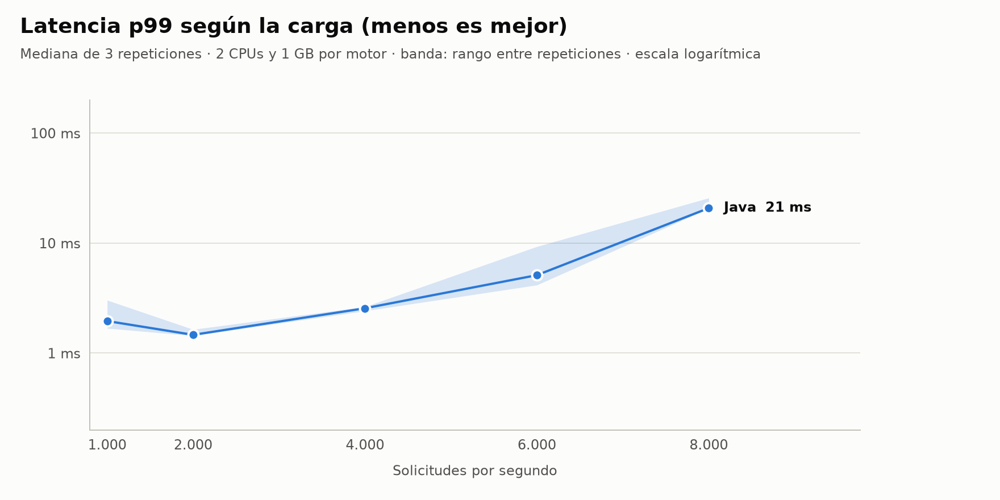
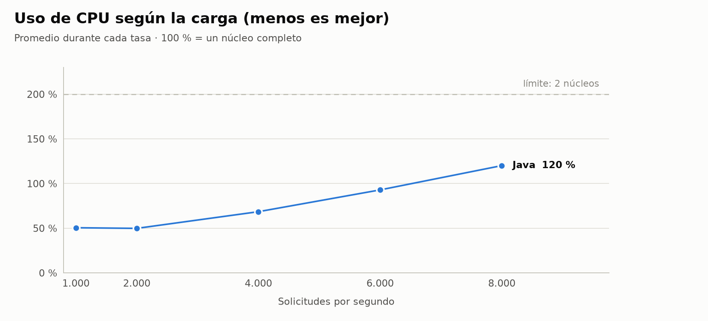

# Prueba de carga

Mide cuántas solicitudes de combinaciones atiende el motor y con qué latencia, en
condiciones controladas y reproducibles.

## Cómo correrla

```sh
python3 -m venv bench/.venv && bench/.venv/bin/pip install -r bench/requirements.txt   # una vez (gráficas)

bench/micro.sh                                          # microbenchmarks con JMH → results/micro.json
bench/run.sh                                            # 3 repeticiones, tasas por defecto
REPS=5 RATES="1000 2000" DURATION=60s bench/run.sh
MAX_COMBINATIONS=50 OUT=bench/results-50 bench/run.sh   # otra variante, en otra carpeta
```

Requiere Docker, Java 25 y Python 3. El script construye la imagen, carga el catálogo con el
simulador de institución y deja el reporte en `results/report.md` y las gráficas en
`results/*.png` (versión clara y oscura).

## Cómo se garantizan condiciones controladas

| Condición | Cómo se controla |
|---|---|
| Mismos datos | Catálogo (5.000 grupos de 1.000 cursos) y 50.000 estudiantes generados con **semilla fija** (`generate_scenario.py`) |
| Mismas solicitudes, en el mismo orden | k6 recorre `students.json` en orden (`iterationInTest`), no elige al azar |
| Mismo punto de partida | Cada repetición arranca desde cero: NATS vacío y el motor recién iniciado |
| Núcleos fijos | El motor corre en las CPUs `4,6`: dos núcleos físicos cuyos hermanos de hiperhilo (5, 7) quedan libres. NATS en `2,3`, k6 en `8-15`. Ajustable con `ENGINE_CPUS`, `NATS_CPUS` y `K6_CPUS` según el procesador |
| Memoria | Límite de 1 GB para el motor |
| CPUs que detecta la JVM | El motor registra al arrancar cuántas CPUs ve (la JVM dimensiona sus hilos con ese número); el script avisa si no coinciden con los núcleos asignados |
| Sin proxy de puertos | k6 entra por la red interna de Docker (de contenedor a contenedor) |
| Variación | 3 repeticiones; se reporta la **mediana** y el rango del p99 |
| Colas vacías entre tasas | Pausa de 5 s entre una tasa y la siguiente |
| Entorno registrado | Fecha, CPU, kernel, modo de frecuencia, versiones e ID de la imagen, carga del sistema antes de cada repetición |
| Combinaciones por respuesta | Hasta 5 por defecto (`MAX_COMBINATIONS`), lo que verá el estudiante |

Antes de medir: cerrar programas pesados y, si es posible, poner el procesador en modo
`performance` (`sudo cpupower frequency-set -g performance`); el modo usado queda en el reporte.

## Resultados (06-10-2026)

Mediana de 3 repeticiones, motor con 2 CPUs y 1 GB, hasta 5 combinaciones por respuesta,
catálogo de 5.000 grupos. Reporte completo, con el entorno, en [`results/report.md`](results/report.md).

### Arranque y memoria

| | Valor |
|---|---|
| Arranque hasta `/ready` | 4,26 s |
| Memoria en reposo, con el catálogo cargado | 147 MB |
| Memoria máxima bajo carga (8.000/s) | 340 MB |
| Imagen Docker | 591 MB |

### Latencia y capacidad

<picture>
  <source media="(prefers-color-scheme: dark)" srcset="results/latency-p99-dark.png">
  
</picture>

| Solicitudes/s | p50 (ms) | p99 (ms) | p99 mín–máx | CPU (de 200 %) |
|---|---|---|---|---|
| 200 (en frío) | 1,10 | 3,81 | 3,72–4,00 | 48 % |
| 1.000 | 0,48 | 1,96 | 1,68–3,02 | 50 % |
| 2.000 | 0,39 | 1,47 | 1,44–1,64 | 50 % |
| 4.000 | 0,27 | 2,56 | 2,42–2,64 | 68 % |
| 6.000 | 0,25 | 5,11 | 4,16–9,30 | 93 % |
| 8.000 | 0,24 | 21 | 21–26 | 120 % |

<picture>
  <source media="(prefers-color-scheme: dark)" srcset="results/cpu-dark.png">
  
</picture>

Ninguna solicitud falló ni quedó sin atender en ninguna tasa.

### Microbenchmarks (solo el cálculo, sin HTTP)

| | Tiempo promedio |
|---|---|
| Backtracking, 6 cursos × 5 grupos, hasta 500 combinaciones | 50 µs |
| Buscar los grupos de 6 cursos en un catálogo de 5.000 grupos | 0,73 µs |

### Lectura

- **Hasta 4.000 solicitudes por segundo**, el 99 % responde en menos de 3 ms usando un tercio
  de la CPU asignada; a 8.000/s sigue sin descartar solicitudes, pero la cola sube a ~20 ms.
- Como referencia de capacidad: 20.000 estudiantes haciendo 20 consultas en la misma hora
  son ~110 solicitudes/s en promedio, con picos de ~1.100/s. Una instancia de 2 CPUs lo
  cubre con amplio margen; dos instancias dan además tolerancia a fallos.
- Para más carga: más réplicas de consulta detrás de Traefik
  ([ADR 0005](../docs/adr/0005-varias-instancias-con-historial-compartido.md)).

### Limitaciones

- El generador de carga corre en la misma máquina que el motor, aunque en núcleos separados.
- El procesador estaba en modo `schedutil` (frecuencia variable), no en `performance`.
- Configuración por defecto de Spring Boot y de la JVM, sin afinar.
