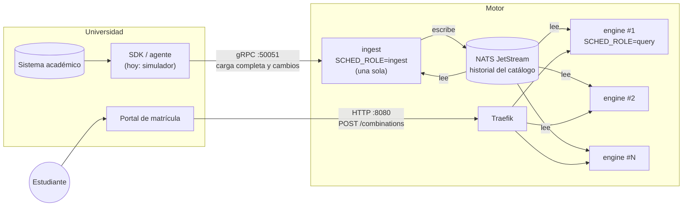
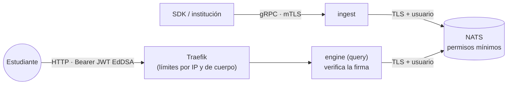
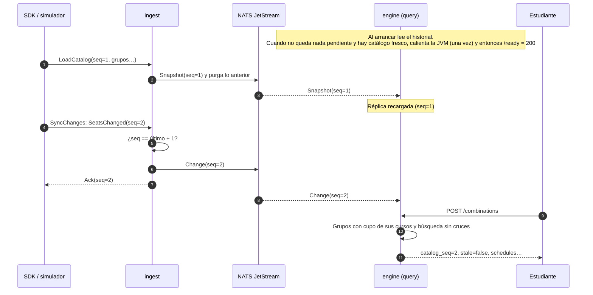
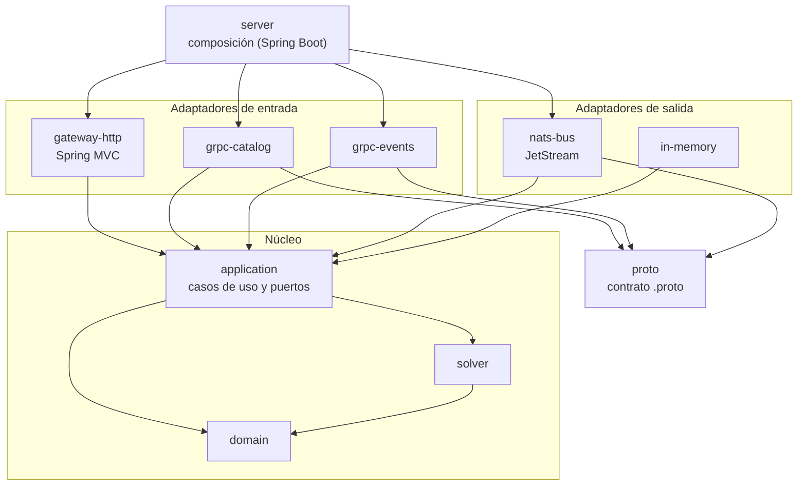

# Arquitectura

Cómo está armado el motor y cómo fluyen los datos. El porqué de cada decisión está en los
[ADRs](adr/); aquí se explica cómo encajan las piezas.

## La idea en una frase

La institución **empuja** su catálogo (grupos, horarios y cupos) al motor. El motor guarda una
**réplica en memoria** y, cuando un estudiante pregunta, calcula al instante qué combinaciones
de grupos son compatibles. Nunca consulta a la institución durante una solicitud
([ADR 0002](adr/0002-roles-de-la-institucion.md)).

## Despliegue

- **Una sola instancia de ingesta** recibe los datos de la institución, valida el orden de los
  cambios (`seq`) y los escribe en el historial. Tener un solo escritor evita coordinar la
  numeración entre varias instancias ([ADR 0005](adr/0005-varias-instancias-con-historial-compartido.md)).
- **NATS JetStream** guarda el historial: la última carga completa y los cambios posteriores.
  Al escribir una carga completa se borra lo anterior, así que el historial nunca crece sin
  límite.
- **Todas las instancias**, la de ingesta incluida, leen el historial en orden y lo aplican a
  su réplica local. Mismas entradas en el mismo orden producen el mismo catálogo en todas.
- **Las instancias de consulta** se escalan horizontalmente detrás de Traefik, que solo les
  envía tráfico cuando `/ready` responde 200, es decir, cuando su réplica ya está al día y la JVM ya se calentó
  (consultas sintéticas en proceso, 10-60 s la primera vez; ver [Calentamiento de la JVM](inicio-rapido.md#calentamiento-de-la-jvm)).
- Con `SCHED_ROLE=all`, un solo proceso hace ingesta y consultas. Sirve para desarrollo y
  despliegues pequeños, pero igual necesita NATS.

El SDK todavía no existe; hoy su papel lo cumple el simulador. Ver [sdk.md](sdk.md).

## Seguridad

El motor se despliega en la infraestructura de la institución y maneja datos académicos, así que
cada frontera tiene su control. Los valores por defecto son los seguros; relajarlos es siempre
una decisión explícita y el motor lo advierte en el log.

| Frontera | Control | Configuración |
|---|---|---|
| Institución → ingesta (gRPC) | TLS con **autenticación mutua**: solo conecta un cliente con certificado firmado por la CA de la institución | `SCHED_GRPC_TLS=required` (defecto), `SCHED_GRPC_TLS_CERT/KEY/CLIENT_CA`. Sin los archivos no arranca |
| Estudiante → consultas (HTTP) | **Token firmado** (JWT EdDSA/Ed25519) por la institución, con vida corta; el contexto del estudiante sale del token ([ADR 0004](adr/0004-contexto-del-estudiante-en-token-firmado.md)) | `SCHED_AUTH=jwt` (defecto), `SCHED_JWT_*`. Sin llaves no arranca. `/health` y `/ready` quedan sin token |
| Motor → NATS | Usuario y contraseña (o token), TLS opcional y permisos mínimos: el usuario solo publica en `<prefijo>.catalog.>` y usa la API de su stream | `SCHED_NATS_USER/PASSWORD/TOKEN`, `SCHED_NATS_TLS_CA`, `deploy/nats/nats.conf` |
| Internet → balanceador | Traefik sin panel, con límite de solicitudes por IP y simultáneas, y de tamaño del cuerpo | etiquetas de `engine` en `deploy/docker-compose.yml` |
| Dentro del motor | Límites de cursos, ventanas e ids por solicitud, tamaño de cuerpo y tiempo máximo de búsqueda | `SCHED_MAX_*`, `SCHED_SEARCH_TIMEOUT_MS` |

Criterios que guían estos controles:

- **Confidencialidad:** los canales entre partes distintas van cifrados. El TLS del HTTP de los
  estudiantes se termina en el ingress de la institución (o en Traefik con su propio
  certificado): el despliegue de desarrollo lo sirve en claro. La autenticación mutua evita que
  un tercero se haga pasar por la institución al enviar el catálogo.
- **El motor no conserva datos personales:** no tiene base de datos; el catálogo está en memoria
  y en el historial de NATS (sin estudiantes); el contexto del estudiante vive solo durante la
  solicitud y los logs nunca incluyen el token ni su contenido (solo un motivo genérico y el
  `kid`).
- **Integridad del contexto:** el estudiante no puede alterar sus cursos habilitados porque salen
  de un token cuya firma solo la institución puede producir. La verificación vive en el adaptador
  HTTP (`JwtAuthFilter`, `JwtVerifier`); los casos de uso reciben el contexto ya verificado y no
  saben de tokens.
- **Secretos fuera del repositorio:** certificados, llaves y contraseñas de desarrollo los genera
  `deploy/setup-dev.sh` y están en `.gitignore`. En producción los entrega el gestor de secretos
  de la institución.

Pendiente (no cubierto aquí): el WebSocket de avisos en vivo, cuando exista, debe verificar el
mismo token al abrirse; la rotación automática de certificados; y un proxy de solo lectura para el
socket de Docker de Traefik en lugar de montarlo directamente.

## Recorrido de los datos

Si llega un `seq` con hueco (por ejemplo 5 cuando se esperaba 3), la ingesta responde
`ResyncRequired`, escribe `SyncLost` en el historial y todas las réplicas pasan a marcar sus
respuestas con `stale = true` hasta la siguiente carga completa. Lo mismo ocurre si se cierra
la conexión de cambios. El protocolo completo está en
[contrato-institucion.md](contrato-institucion.md).

## Capas (arquitectura hexagonal)

Cada capa es un módulo Maven. Las dependencias solo apuntan hacia adentro y Maven impide lo
contrario: el dominio no puede importar Spring, gRPC ni NATS porque no los tiene como
dependencia ([ADR 0001](adr/0001-arquitectura-hexagonal.md)). Además, las reglas de ArchUnit de
[`quality`](../quality/src/test/java/sched/architecture/ArchitectureTest.java) lo vigilan en cada
`verify` (ver [Pruebas y calidad](#pruebas-y-calidad)): una dependencia indebida, aunque
compile, rompe la build.

| Módulo | Qué contiene | Depende de |
|---|---|---|
| `domain` | Modelo puro: `Catalog`, `Section`, `TimeSlot`, `CatalogEvent`. Sin dependencias externas | nada |
| `solver` | `ForwardCheckingSolver` y `BacktrackingSolver`: búsqueda de combinaciones sin cruces | `domain` |
| `application` | Casos de uso, `CatalogReplica` y los puertos `CatalogLog` y `EngineMetrics` | `domain`, `solver` |
| `proto` | Los `.proto` y `Convert`, que traduce entre protobuf y el dominio | `domain` |
| `adapters/*` | Traducen el mundo exterior (HTTP, gRPC, NATS) a llamadas a los casos de uso | `application`, `proto` |
| `server` | Crea los adaptadores y los conecta según `SCHED_ROLE`. Es el único que conoce todo | todos |
| `simulation` | Institución simulada y simulador de escenarios | `application`, `solver`, `proto`, `in-memory` |
| `benchmarks` | Microbenchmarks JMH del solver y del catálogo | `solver`, `domain` |
| `quality` | Reglas de arquitectura (ArchUnit) y reporte agregado de cobertura (JaCoCo). Sin código de producción | todos (solo lee sus clases) |

## Qué clase hace qué

Para entender el código, conviene leerlo en este orden:

1. **Modelo** — [`Catalog`](../domain/src/main/java/sched/domain/Catalog.java): el catálogo
   en memoria. `apply` aplica un cambio respetando el orden de `seq` y `openSectionsOf`
   devuelve los grupos con cupo de unos cursos.
2. **Búsqueda** — [`ForwardCheckingSolver`](../solver/src/main/java/sched/solver/ForwardCheckingSolver.java)
   (por defecto, `SCHED_SOLVER=forward-checking`): búsqueda con retroceso donde cada curso es
   una variable y sus grupos son su dominio. Las franjas de cada grupo se codifican como un
   vector de bits exacto ([`SlotBitmaps`](../solver/src/main/java/sched/solver/SlotBitmaps.java):
   dos grupos se cruzan si y solo si el AND de sus máscaras no es cero) y los conflictos entre
   grupos se precalculan. Al elegir un grupo se quitan de los demás cursos los que chocan con
   él (forward checking); si un dominio queda vacío se retrocede de inmediato. Se asigna
   primero el curso con menos grupos restantes (MRV) y sus grupos se prueban por menor costo y
   luego por id, de modo que la salida es determinista.

   `Problem` admite un `SectionCost` opcional (no negativo, aditivo por curso). Con costo, el
   solver devuelve las `SCHED_MAX_COMBINATIONS` combinaciones de menor costo total con
   ramificación y poda (cota = costo parcial + menor costo posible de cada curso pendiente);
   sin costo se detiene en cuanto reúne las primeras. `solveScored` expone el costo de cada
   resultado. [`BacktrackingSolver`](../solver/src/main/java/sched/solver/BacktrackingSolver.java)
   (`SCHED_SOLVER=backtracking`) es la línea base: enumera y poda por cruce par a par; con costo
   enumera todo y ordena. Los microbenchmarks los comparan
   ([`SolverComparisonBenchmark`](../benchmarks/src/main/java/sched/benchmarks/SolverComparisonBenchmark.java);
   ver [bench/README.md](../bench/README.md#comparar-los-solvers)).
3. **Casos de uso** (en [`application`](../application/src/main/java/sched/application/)):

   | Clase | Cuándo se ejecuta | Qué hace |
   |---|---|---|
   | `GenerateCombinations` | `POST /combinations` | Lee la réplica y llama al solver |
   | `SuggestAlternatives` | `POST /alternatives` | Con la selección actual del estudiante, propone combinaciones que cambian lo mínimo (distancia, luego penalización), codificadas en un solo costo aditivo para el solver |
   | `IngestCatalog` | `LoadCatalog` (gRPC) | Escribe la carga completa en el historial |
   | `IngestCatalogEvent` | `SyncChanges` (gRPC) | Valida el `seq` con `IngestState` y escribe el cambio |
   | `ApplyLogEntry` | Por cada entrada del historial | Aplica la entrada a la réplica local |

4. **Estado compartido** — `CatalogReplica` (réplica con lectura concurrente y bandera
   `stale`), `IngestState` (último `seq` aceptado, solo en la ingesta) y `Readiness` (si la
   réplica ya está al día).
5. **Composición** — [`EngineConfig`](../server/src/main/java/sched/server/EngineConfig.java):
   qué se crea según el rol. Es el mejor punto de partida para ver cómo se conecta todo.

## Observabilidad

El motor se mide por fuera del núcleo: `domain`, `solver` y `application` no conocen Micrometer
(una regla de ArchUnit lo exige). `application` define el puerto
[`EngineMetrics`](../application/src/main/java/sched/application/ports/EngineMetrics.java), con
una implementación que no hace nada por defecto, y `server` lo implementa con Micrometer
(`MicrometerEngineMetrics`). Así el mismo código de los casos de uso corre con o sin medición.

**Puerto de administración.** `/actuator/prometheus` y `/actuator/health` se sirven en
`SCHED_MANAGEMENT_PORT` (por defecto `8081`), aparte del `8080` de los estudiantes. Ese puerto no
pasa por Traefik (que solo enruta el `8080`), no exige token y no expone ningún otro endpoint de
actuator (`env`, `beans`, `heapdump`... responden 404). **Solo debe alcanzarse desde la red
interna** (Prometheus): no lo publique al host ni lo ponga detrás del balanceador. Las sondas
`/health` y `/ready` siguen en el `8080` y son las que usa el orquestador.

**Métricas** (los nombres de Prometheus llevan el sufijo de su unidad: `_seconds`, `_total`):

| Métrica | Tipo | Qué mide |
|---|---|---|
| `sched_http_latency_seconds{endpoint,status}` | histograma | Latencia de `/combinations` y `/alternatives`, con cubetas de 10, 25, 50, 100, **200** (el SLO del escenario E2), 500 ms y 1 s. De él salen los percentiles de todo el servicio con `histogram_quantile` |
| `sched_http_latency_quantiles_seconds{endpoint,status,quantile}` | resumen | p50, p95 y p99 de esa réplica (no se promedian entre réplicas; use el histograma para eso) |
| `sched_http_rejected_total{status}` | contador | Rechazos 4xx del motor: `401` (sin token o inválido), `400` (cuerpo inválido o contradice al token), `413` (cuerpo grande), `422` (tope de créditos) |
| `sched_search_duration_seconds{operation}` y `..._quantiles_seconds` | histograma y resumen | Solo la búsqueda del solver, sin la lectura de la réplica ni el HTTP; `operation` es `combinations` o `alternatives` |
| `sched_search_nodes{operation}` | resumen de distribución | Nodos explorados por búsqueda (solo `forward-checking`; el solver `backtracking` no los informa) |
| `sched_search_incomplete_total{operation}` | contador | Búsquedas cortadas por `SCHED_SEARCH_TIMEOUT_MS` (respuesta con `complete=false`): la medida que deja pendiente el [ADR 0009](adr/0009-tiempo-maximo-de-la-busqueda.md) |
| `sched_search_empty_total{operation}` | contador | Búsquedas sin ninguna combinación |
| `sched_replica_seq` | gauge | `seq` del catálogo de la réplica (`-1` si aún no hay carga completa) |
| `sched_replica_stale` | gauge 0/1 | `1` si la réplica está desactualizada ([ADR 0003](adr/0003-replica-del-catalogo.md)) |
| `sched_replica_ready` | gauge 0/1 | Lo mismo que `/ready`: `1` si la instancia recibe tráfico (incluye que ya se calentó) |
| `sched_warmup_duration_seconds` | gauge | Segundos que duró el calentamiento de la JVM; `-1` mientras no ha terminado (solo roles `query` y `all` con `SCHED_WARMUP=on`) |
| `sched_warmup_searches` | gauge | Solicitudes sintéticas que ejecutó el calentamiento. No cuentan en `sched_search_*` ni en `sched_http_*` |
| `sched_follower_lag` | gauge | Mensajes del historial que el follower aún no lee (`0` = al día) |
| `sched_follower_resyncs_total` | contador | Veces que el follower perdió NATS y empezó a releer el historial |
| `sched_ingest_events_total{outcome}` | contador | Cambios de la institución: `applied`, `duplicate`, `gap` (rechazado, pide carga completa) y `failed` (no se pudo escribir) |
| `sched_ingest_snapshots_total` | contador | Cargas completas escritas |
| `sched_ingest_sync_lost_total` | contador | Avisos de pérdida de sincronía con la institución |

Además salen las métricas estándar de la JVM y de Tomcat que publica Spring Boot. Todas llevan la
etiqueta `application="sched-engine"`; Prometheus añade `instance`. Las etiquetas son de cardinalidad
fija: ninguna lleva ids de estudiante, de curso ni de grupo.

Para verlas, en el despliegue de desarrollo: `docker compose -f deploy/docker-compose.yml --profile
observability up -d` y abrir <http://localhost:9090> (ver [inicio-rapido.md](inicio-rapido.md#métricas-y-logs)).
[`deploy/prometheus/rules.yml`](../deploy/prometheus/rules.yml) trae reglas de ejemplo: percentiles del
servicio, fracción de solicitudes dentro de 200 ms y alertas de p99, búsquedas cortadas y réplica
desactualizada.

**Logs.** `SCHED_LOG_FORMAT=text` (por defecto) o `json` (un objeto JSON por línea, formato ECS de
Spring Boot, para un recolector de logs). Cada solicitud HTTP lleva un **id de correlación**: se acepta
la cabecera `X-Request-Id` si es segura (letras, dígitos, `.`, `_`, `-`; hasta 64 caracteres), si no se
genera un UUID; se devuelve en la respuesta y va en el MDC como `request_id`, así que aparece en cada
línea de log de esa solicitud (en `json`, como campo; en `text`, entre corchetes). También lo llevan
los 401. Lo aplica [`RequestIdFilter`](../adapters/gateway-http/src/main/java/sched/adapters/http/RequestIdFilter.java),
el primero de la cadena de filtros.

**Política de confidencialidad de los logs.** El motor no conserva datos personales y los logs no
deben convertirse en un lugar donde sí se conserven:

- Nunca se registran el token (ni la cabecera `Authorization`, ni sus tramos), el cuerpo de la
  solicitud ni el id o los cursos del estudiante. Un rechazo registra solo el motivo genérico
  (`firma_invalida`, `token_mal_formado`...) y el `kid` de la llave, que es público.
- Las etiquetas de las métricas no llevan datos del estudiante.
- Si algún día hiciera falta correlacionar con un estudiante, use un identificador truncado y con
  hash, nunca el id (hay que decidirlo con la institución, porque aun así es un seudónimo).
- Spring MVC, en nivel DEBUG, registra el cuerpo ya leído (`Read "application/json" to [...]`). Por
  eso `application.properties` fija `org.springframework.web` en INFO aunque el nivel raíz sea DEBUG.
  **No lo baje en producción.**
- Lo comprueban [`LogConfidentialityTest`](../server/src/test/java/sched/server/LogConfidentialityTest.java)
  y la prueba de extremo a extremo, que capturan los logs con nivel DEBUG y verifican que no aparece
  ningún token, trozo de token, cuerpo ni id de estudiante.

## Pruebas y calidad

`./mvnw verify` ejecuta, además de las pruebas unitarias de cada módulo:

| Qué | Dónde | Cómo |
|---|---|---|
| **Reglas de arquitectura** (ArchUnit) | [`quality`](../quality/src/test/java/sched/architecture/ArchitectureTest.java) | `domain` solo depende de `java.*`; `solver`, solo de `domain`; `application`, de `domain`, `solver` y SLF4J (nada de adaptadores, `server`, Spring, gRPC, protobuf, NATS, Jackson ni Micrometer); los adaptadores no dependen entre sí; nada depende de `server`, `simulation` ni `benchmarks`; sin ciclos entre los paquetes de primer nivel |
| **Cobertura** (JaCoCo) | `target/site/jacoco` de cada módulo y `quality/target/site/jacoco-aggregate` (agregado) | `domain`, `solver` y `application` tienen un umbral mínimo de cobertura (líneas y ramas) que hace fallar `verify` si baja; el código generado de protobuf no cuenta. Umbrales y cómo subirlos: [CONTRIBUTING.md](../CONTRIBUTING.md#cobertura) |
| **Integración con NATS real** (Testcontainers) | [`JetStreamIntegrationTest`](../adapters/nats-bus/src/test/java/sched/adapters/nats/JetStreamIntegrationTest.java) | `JetStreamCatalogLog` escribe una carga completa troceada (más de 500 grupos, con créditos y reglas) y cambios; `CatalogFollower` la sigue y la réplica queda igual; un hueco la deja desactualizada y no lista; una carga completa la recupera; NATS se cae y vuelve y el follower se reconecta |
| **Extremo a extremo** | [`EngineEndToEndTest`](../server/src/test/java/sched/server/EngineEndToEndTest.java) | El motor completo arrancado con Spring Boot y puerto real, NATS real, mTLS en la ingesta y token Ed25519: carga por gRPC, consultas HTTP con JSON real, 401, 400, 413, 422, hueco y recuperación, métricas en el puerto de administración, id de correlación y logs sin datos |

Las pruebas con Testcontainers usan `@Testcontainers(disabledWithoutDocker = true)`: sin Docker se
saltan (no fallan) y el resto de la build pasa. En la CI (`ubuntu-latest` trae Docker) siempre
corren. Todas caben en `verify` (la más lenta tarda unos 10 s); no hizo falta un perfil aparte.

## Dónde agregar cosas

| Quiero… | Lo hago en… |
|---|---|
| Cambiar una regla del horario (por ejemplo, tiempo mínimo entre clases) | `domain` o `solver`, con su prueba |
| Agregar un filtro del estudiante ([ADR 0006](adr/0006-mejores-combinaciones-con-ramificacion-y-poda.md)) | `solver` (`Problem`), y exponerlo en `gateway-http` |
| Exponer un endpoint nuevo | `gateway-http`, que llame a un caso de uso de `application` |
| Cambiar el contrato con la institución | `proto/src/main/proto/institution/v1/`, más `Convert` y el adaptador gRPC |
| Cambiar cómo se guarda el historial | Una nueva implementación de `CatalogLog`, conectada en `server` |
| Medir algo nuevo del núcleo | Un método en el puerto `EngineMetrics` (`application`), llamado desde el caso de uso, e implementado con Micrometer en `server` (`MicrometerEngineMetrics`); documentarlo en [Observabilidad](#observabilidad) |
| Agregar una regla de arquitectura | `quality/src/test/java/sched/architecture/ArchitectureTest.java` |

Para las convenciones de trabajo, ver [CONTRIBUTING.md](../CONTRIBUTING.md).
