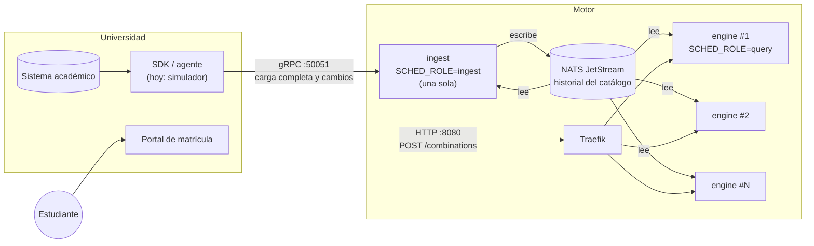
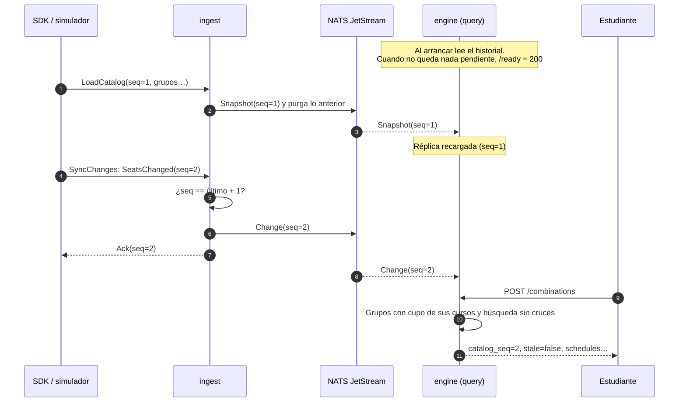
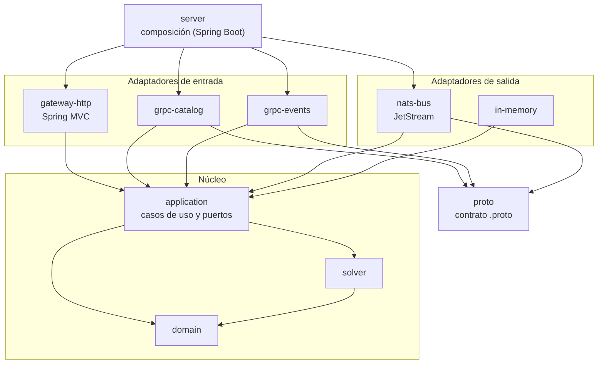

# Arquitectura

Cómo está armado el motor y cómo fluyen los datos. El porqué de cada decisión está en los
[ADRs](adr/); aquí se explica cómo encajan las piezas.

## La idea en una frase

La institución **empuja** su catálogo (grupos, horarios y cupos) al motor. El motor guarda una
**réplica en memoria** y, cuando un estudiante pregunta, calcula al instante qué combinaciones
de grupos son compatibles. Nunca consulta a la institución durante una solicitud
([ADR 0002](adr/0002-roles-de-la-institucion.md)).

## Despliegue

- **Una sola instancia de ingesta** recibe los datos de la institución, valida el orden de los
  cambios (`seq`) y los escribe en el historial. Tener un solo escritor evita coordinar la
  numeración entre varias instancias ([ADR 0005](adr/0005-varias-instancias-con-historial-compartido.md)).
- **NATS JetStream** guarda el historial: la última carga completa y los cambios posteriores.
  Al escribir una carga completa se borra lo anterior, así que el historial nunca crece sin
  límite.
- **Todas las instancias**, la de ingesta incluida, leen el historial en orden y lo aplican a
  su réplica local. Mismas entradas en el mismo orden producen el mismo catálogo en todas.
- **Las instancias de consulta** se escalan horizontalmente detrás de Traefik, que solo les
  envía tráfico cuando `/ready` responde 200, es decir, cuando su réplica ya está al día.
- Con `SCHED_ROLE=all`, un solo proceso hace ingesta y consultas. Sirve para desarrollo y
  despliegues pequeños, pero igual necesita NATS.

El SDK todavía no existe; hoy su papel lo cumple el simulador. Ver [sdk.md](sdk.md).

## Recorrido de los datos

Si llega un `seq` con hueco (por ejemplo 5 cuando se esperaba 3), la ingesta responde
`ResyncRequired`, escribe `SyncLost` en el historial y todas las réplicas pasan a marcar sus
respuestas con `stale = true` hasta la siguiente carga completa. Lo mismo ocurre si se cierra
la conexión de cambios. El protocolo completo está en
[contrato-institucion.md](contrato-institucion.md).

## Capas (arquitectura hexagonal)

Cada capa es un módulo Maven. Las dependencias solo apuntan hacia adentro y Maven impide lo
contrario: el dominio no puede importar Spring, gRPC ni NATS porque no los tiene como
dependencia ([ADR 0001](adr/0001-arquitectura-hexagonal.md)).

| Módulo | Qué contiene | Depende de |
|---|---|---|
| `domain` | Modelo puro: `Catalog`, `Section`, `TimeSlot`, `CatalogEvent`. Sin dependencias externas | nada |
| `solver` | `BacktrackingSolver`: búsqueda de combinaciones sin cruces | `domain` |
| `application` | Casos de uso, `CatalogReplica` y el puerto `CatalogLog` | `domain`, `solver` |
| `proto` | Los `.proto` y `Convert`, que traduce entre protobuf y el dominio | `domain` |
| `adapters/*` | Traducen el mundo exterior (HTTP, gRPC, NATS) a llamadas a los casos de uso | `application`, `proto` |
| `server` | Crea los adaptadores y los conecta según `SCHED_ROLE`. Es el único que conoce todo | todos |
| `simulation` | Institución simulada y simulador de escenarios | `application`, `solver`, `proto`, `in-memory` |
| `benchmarks` | Microbenchmarks JMH del solver y del catálogo | `solver`, `domain` |

## Qué clase hace qué

Para entender el código, conviene leerlo en este orden:

1. **Modelo** — [`Catalog`](../domain/src/main/java/sched/domain/Catalog.java): el catálogo
   en memoria. `apply` aplica un cambio respetando el orden de `seq` y `openSectionsOf`
   devuelve los grupos con cupo de unos cursos.
2. **Búsqueda** — [`BacktrackingSolver`](../solver/src/main/java/sched/solver/BacktrackingSolver.java):
   para cada curso prueba sus grupos y descarta los que se cruzan con lo ya elegido. Se
   detiene al llegar a `SCHED_MAX_COMBINATIONS`.
3. **Casos de uso** (en [`application`](../application/src/main/java/sched/application/)):

   | Clase | Cuándo se ejecuta | Qué hace |
   |---|---|---|
   | `GenerateCombinations` | `POST /combinations` | Lee la réplica y llama al solver |
   | `IngestCatalog` | `LoadCatalog` (gRPC) | Escribe la carga completa en el historial |
   | `IngestCatalogEvent` | `SyncChanges` (gRPC) | Valida el `seq` con `IngestState` y escribe el cambio |
   | `ApplyLogEntry` | Por cada entrada del historial | Aplica la entrada a la réplica local |

4. **Estado compartido** — `CatalogReplica` (réplica con lectura concurrente y bandera
   `stale`), `IngestState` (último `seq` aceptado, solo en la ingesta) y `Readiness` (si la
   réplica ya está al día).
5. **Composición** — [`EngineConfig`](../server/src/main/java/sched/server/EngineConfig.java):
   qué se crea según el rol. Es el mejor punto de partida para ver cómo se conecta todo.

## Dónde agregar cosas

| Quiero… | Lo hago en… |
|---|---|
| Cambiar una regla del horario (por ejemplo, tiempo mínimo entre clases) | `domain` o `solver`, con su prueba |
| Agregar un filtro del estudiante ([ADR 0006](adr/0006-mejores-combinaciones-con-ramificacion-y-poda.md)) | `solver` (`Problem`), y exponerlo en `gateway-http` |
| Exponer un endpoint nuevo | `gateway-http`, que llame a un caso de uso de `application` |
| Cambiar el contrato con la institución | `proto/src/main/proto/institution/v1/`, más `Convert` y el adaptador gRPC |
| Cambiar cómo se guarda el historial | Una nueva implementación de `CatalogLog`, conectada en `server` |

Para las convenciones de trabajo, ver [CONTRIBUTING.md](../CONTRIBUTING.md).
