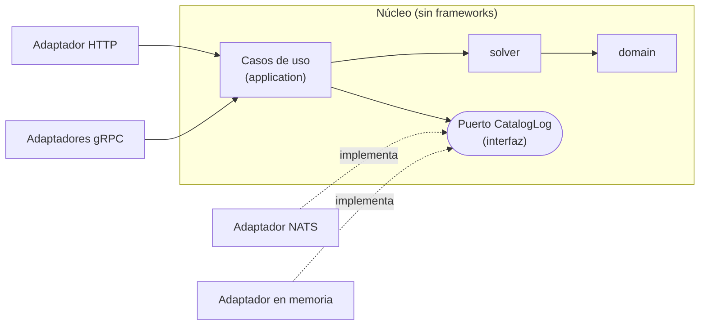

# Conceptos base: las tecnologías explicadas desde cero

Este documento es para quien llega al proyecto sin haber oído hablar de Spring, Docker, gRPC, NATS,
JWT o Maven. Si sabes programar a nivel universitario básico, con esto puedes entender qué hace cada
tecnología, **por qué la usamos aquí** y dónde mirar en el repositorio.

Cada sección sigue el mismo orden:

- **Qué es**: explicado sin jerga, con una analogía cuando ayuda.
- **Para qué la usamos**: el papel concreto en este proyecto.
- **Dónde aparece**: rutas del repositorio.
- **Cómo verla funcionando**: un comando o archivo que puedes abrir.
- **Para aprender más**: enlace a la documentación oficial.

Todos los comandos se corren desde la raíz del repositorio. Si un término no está aquí, mira el
[glosario](glosario.md), que traduce los términos del *dominio* (grupo, cupo, franja…) y su nombre en
el código.

**Índice**

1. [Java, JDK y JVM](#java-jdk-y-jvm) · [JIT y calentamiento](#jit-y-calentamiento) · [Recolector de basura](#recolector-de-basura)
2. [Maven y el wrapper `./mvnw`](#maven-y-el-wrapper-mvnw) · [Módulos](#módulos-de-maven) · [Jar ejecutable](#jar-ejecutable)
3. [Spring Boot](#spring-boot) · [Spring MVC](#spring-mvc) · [Tomcat](#tomcat) · [Hilos virtuales](#hilos-virtuales) · [Actuator](#actuator)
4. [HTTP, JSON y REST](#http-json-y-rest) · [Jackson](#jackson)
5. [Arquitectura hexagonal](#arquitectura-hexagonal-puertos-y-adaptadores)
6. [gRPC y Protocol Buffers](#grpc-y-protocol-buffers)
7. [TLS, mTLS, certificados y OpenSSL](#tls-mtls-certificados-ca-y-openssl)
8. [JWT y Bearer](#jwt-y-bearer) · [Ed25519](#firma-eddsa-ed25519-y-llaves-pública-y-privada) · [`kid`](#kid-el-identificador-de-la-llave) · [BouncyCastle](#bouncycastle)
9. [NATS y JetStream](#nats-y-jetstream)
10. [Docker](#docker) · [Compose](#docker-compose) · [Healthcheck](#healthcheck) · [Traefik](#traefik) · [Kubernetes](#kubernetes-solo-como-guía)
11. [Prometheus, Micrometer y métricas](#prometheus-micrometer-y-métricas) · [Logs y ECS](#logs-y-formato-ecs)
12. [Pruebas](#pruebas-automáticas): [JUnit 5](#junit-5) · [jqwik](#pruebas-basadas-en-propiedades-jqwik) · [Testcontainers](#testcontainers) · [ArchUnit](#archunit) · [JaCoCo](#jacoco-y-la-cobertura)
13. [Medición de rendimiento](#medición-de-rendimiento): [JMH](#jmh) · [k6](#k6) · [async-profiler y JFR](#async-profiler-y-jfr) · [Python y matplotlib](#python-y-matplotlib)
14. [GitHub Actions](#github-actions-integración-continua)
15. [El problema del horario y el solver](#el-problema-del-horario-y-el-solver): [CSP](#csp-problema-de-satisfacción-de-restricciones) · [Backtracking](#backtracking) · [Forward checking](#forward-checking) · [MRV](#mrv) · [Ramificación y poda](#ramificación-y-poda)
16. [Estadística del simulador, a nivel intuitivo](#estadística-del-simulador-a-nivel-intuitivo)
17. [Convenciones](#convenciones-del-repositorio): [Mermaid](#mermaid) · [Conventional Commits](#conventional-commits) · [ADR](#adr-decisiones-de-arquitectura)
18. [Piezas del SDK propuesto](#piezas-del-sdk-propuesto-sql-jdbc-postgresql-yaml-y-cdc)

---

## Java, JDK y JVM

**Qué es.** Java es el lenguaje en el que está escrito todo el motor. Un programa Java no se
convierte directamente en código de máquina: se compila a un formato intermedio (`.class`, agrupado en
archivos `.jar`) que ejecuta la **JVM** (*Java Virtual Machine*, la máquina virtual de Java), como un
intérprete universal que traduce ese formato al procesador de tu equipo. El **JDK** (*Java
Development Kit*) es el paquete que trae el compilador (`javac`), la JVM (`java`) y las herramientas;
el **JRE** es solo lo necesario para ejecutar. Analogía: el JDK es un taller completo, el JRE es solo la
sala de máquinas.

**Para qué la usamos.** El proyecto exige **Java 25** (una versión LTS, de soporte largo). Usa
funciones modernas: `record` (clases inmutables de datos), `sealed` y `switch` con patrones, e
[hilos virtuales](#hilos-virtuales).

**Dónde aparece.** `pom.xml` raíz (`<java.version>25</java.version>`); `Dockerfile` (imágenes
`eclipse-temurin:25`).

**Cómo verla.**

```sh
java -version          # debe decir 25 (por ejemplo "openjdk version 25.0.x")
javac -version         # el compilador: si falta, tienes solo el JRE
```

**Para aprender más.** [dev.java/learn](https://dev.java/learn/) (tutoriales oficiales) y
[openjdk.org](https://openjdk.org/) (el JDK de código abierto; hay builds de Temurin, Corretto, etc.).

## JIT y calentamiento

**Qué es.** La JVM empieza ejecutando el código de forma lenta (interpretándolo) y vigila qué partes
se repiten mucho. A esas partes "calientes" las **compila a código de máquina optimizado mientras el
programa corre**: eso es el **JIT** (*Just-In-Time*, "justo a tiempo"). Es como un cocinero novato que
al principio lee la receta paso a paso y, tras repetir un plato cien veces, lo hace de memoria y más
rápido. El costo: durante los primeros segundos o minutos el programa es más lento y el compilador
gasta CPU. A ese periodo se le llama **arranque en frío**, y a prepararlo antes de recibir tráfico real,
**calentamiento** (*warm-up*).

**Para qué la usamos.** Una réplica del motor recién arrancada, con 2 núcleos, sufre cuando
el balanceador le manda de golpe el pico de matrícula: el JIT le quita capacidad justo cuando más se
necesita y las solicitudes se encolan. Por eso el motor **se calienta solo** antes de decir que está
listo: ejecuta consultas sintéticas en proceso y, cuando el compilador se calma (o pasan 60 s), `/ready`
responde `200`. Detalles y medidas: [Calentamiento de la JVM](inicio-rapido.md#calentamiento-de-la-jvm).

**Dónde aparece.** `server/src/main/java/sched/server/Warmup.java`; variables `SCHED_WARMUP*`;
resultados en `bench/results/warmup.md`.

**Cómo verla.** En el log del motor aparecen `calentamiento iniciado` y `calentamiento terminado:
duración=… búsquedas=… motivo=…`. Para ver lo que compila el JIT:
`java -XX:+PrintCompilation -jar server/target/sched-server-exec.jar | head`.

**Para aprender más.** [Visión general de HotSpot](https://docs.oracle.com/en/java/javase/21/vm/java-hotspot-virtual-machine-performance-enhancements.html) (documentación de Oracle).

## Recolector de basura

**Qué es.** En Java no liberas memoria a mano: la JVM tiene un **recolector de basura** (*garbage
collector*, GC) que de vez en cuando detecta los objetos que ya nadie usa y recupera su espacio. Hay
varios recolectores con distintos compromisos entre velocidad y pausas.

**Para qué la usamos.** La imagen Docker arranca la JVM con el recolector **Serial**
(`-XX:+UseSerialGC`), el más simple: con una réplica de unos 2 núcleos y poca memoria gasta menos CPU
por solicitud y tiene menos latencia en los casos peores que G1 (el recolector habitual), según lo
medido en [`bench/results/profile-server.md`](../bench/results/profile-server.md). También limita el
heap al 75 % de la memoria del contenedor (`-XX:MaxRAMPercentage=75`).

**Dónde aparece.** `Dockerfile` (línea `ENTRYPOINT`).

**Cómo verla.** `java -Xlog:gc -jar server/target/sched-server-exec.jar` imprime cada recolección.

**Para aprender más.** [Guía de ajuste del GC](https://docs.oracle.com/en/java/javase/21/gctuning/) (Oracle).

---

## Maven y el wrapper `./mvnw`

**Qué es.** **Maven** es la herramienta que compila el proyecto, ejecuta las pruebas, descarga las
librerías de las que depende y empaqueta el resultado. Se configura con archivos `pom.xml` (*Project
Object Model*) que declaran qué módulos hay y qué librerías usa cada uno. Las librerías se descargan de
un repositorio central y quedan en una caché local (`~/.m2`).
El **wrapper** (`mvnw`, en Windows `mvnw.cmd`) es un script incluido en el repositorio que descarga
y usa **la versión exacta de Maven** que el proyecto espera, así que no tienes que instalar Maven ni
discutir versiones.

**Para qué lo usamos.** Es la única forma oficial de construir y probar:

```sh
./mvnw verify                  # compila todo y corre todas las pruebas (lo mismo que la CI)
./mvnw -q -DskipTests package  # solo compila y empaqueta, sin pruebas (-q = silencioso)
./mvnw -q -pl solver -am test  # pruebas de un solo módulo (-pl) y los que necesita (-am)
```

Ciclo de vida, en orden: `compile` → `test` → `package` (crea los jars) → `verify` (comprobaciones
finales, como cobertura y reglas de arquitectura). Pedir una fase corre también las anteriores.

**Dónde aparece.** `pom.xml` (raíz y uno por módulo), `mvnw`, `.mvn/wrapper/`.

**Cómo verlo.** `./mvnw -v` imprime la versión de Maven y la de Java que usa. La primera vez descarga
bastante y tarda unos minutos.

**Para aprender más.** [Maven en 5 minutos](https://maven.apache.org/guides/getting-started/maven-in-five-minutes.html).

## Módulos de Maven

**Qué es.** Un proyecto Maven grande se divide en **módulos**: carpetas con su propio `pom.xml` que
producen su propio jar y declaran de cuáles otros dependen. El `pom.xml` de la raíz los lista.

**Para qué los usamos.** Cada capa de la [arquitectura hexagonal](#arquitectura-hexagonal-puertos-y-adaptadores)
es un módulo, y Maven **impide** que una capa interna use a una externa: si `domain` no declara
una dependencia, su código simplemente no compila con ella. Los módulos son `domain`, `solver`,
`application`, `proto`, los de `adapters/`, `server`, `simulation`, `benchmarks` y `quality` (índice en
el [README](../README.md#mapa-del-repositorio)).

**Dónde aparece.** Sección `<modules>` de `pom.xml`.

**Cómo verlo.** `./mvnw -q -pl domain test` prueba solo `domain`.

## Jar ejecutable

**Qué es.** Un **jar** (*Java ARchive*) es un `.zip` con clases compiladas. Un jar normal contiene solo
**tu** código y no se puede ejecutar solo, porque le faltan las librerías de las que depende. Un **jar
ejecutable** ("fat jar" o "uber jar") incluye además todas esas librerías y un punto de entrada, de
modo que `java -jar archivo.jar` basta.

**Para qué lo usamos.** El módulo `server` produce **dos** jars en `server/target/`, y es fácil
confundirlos:

| Archivo | Tamaño | Qué es | ¿Se ejecuta con `java -jar`? |
|---|---|---|---|
| `sched-server-exec.jar` | ~54 MB | El motor completo, con todas sus librerías | **Sí**: este es el que se usa |
| `sched-server.jar` | ~50 KB | Solo las clases del módulo `server`, para que otros módulos lo usen como dependencia | No: falla con `no hay ningún atributo de manifiesto principal` |

El `Dockerfile` copia `sched-server-exec.jar` a la imagen (dentro con el nombre `/app/sched-server.jar`,
por eso el nombre del `ENTRYPOINT` no coincide con el de `server/target/`). El simulador sí genera un
solo jar ejecutable: `simulation/target/sched-simulation.jar`.

**Cómo verlo.**

```sh
./mvnw -q -DskipTests package && ls -lh server/target/*.jar simulation/target/sched-simulation.jar
```

**Para aprender más.** [Spring Boot: ejecutable jars](https://docs.spring.io/spring-boot/specification/executable-jar/index.html).

---

## Spring Boot

**Qué es.** **Spring Boot** es un marco (*framework*) para construir aplicaciones Java de servidor. Se
encarga de las partes repetitivas: arrancar el servidor web, leer la configuración (archivos y
variables de entorno), crear los objetos de la aplicación y conectarlos entre sí (*inyección de
dependencias*: en lugar de que cada clase cree lo que necesita, un contenedor se lo entrega ya armado).
Analogía: una cocina equipada donde tú solo escribes las recetas.

**Para qué lo usamos.** Solo en las capas externas: `server` (la composición) y `adapters/gateway-http`
(la API HTTP). El núcleo (`domain`, `solver`, `application`) **no sabe que Spring existe**; una regla de
ArchUnit lo vigila. `EngineConfig` decide qué piezas se crean según el rol (`SCHED_ROLE`).

**Dónde aparece.** `server/src/main/java/sched/server/SchedServer.java` (el `main`), `EngineConfig.java`,
`server/src/main/resources/application.properties` (todas las variables `SCHED_*` con sus valores por
defecto).

**Cómo verlo.** Mira `application.properties`: cada línea `sched.x=${SCHED_X:valor}` significa "usa la
variable de entorno `SCHED_X` y, si no existe, `valor`". Lista completa:
[Configuración](inicio-rapido.md#configuración).

**Para aprender más.** [spring.io/projects/spring-boot](https://spring.io/projects/spring-boot) y su
[documentación de referencia](https://docs.spring.io/spring-boot/index.html).

## Spring MVC

**Qué es.** La parte de Spring para atender solicitudes HTTP: escribes una clase "controlador"
con métodos anotados (por ejemplo, "cuando llegue un `POST /combinations`, ejecuta este método") y Spring
se ocupa de leer la solicitud, convertir el JSON a objetos Java y escribir la respuesta. "MVC" significa
*Model-View-Controller* (modelo-vista-controlador); aquí solo usamos la parte de controladores, porque
respondemos JSON y no páginas.

**Para qué lo usamos.** Es el adaptador de entrada de los estudiantes:
`CombinationsController` (`POST /combinations`), `AlternativesController` (`POST /alternatives`) y
`HealthController` (`/health`, `/ready`). Además hay *filtros* (código que se ejecuta antes del
controlador): verificación del token, id de correlación, límite de tamaño y métricas.

**Dónde aparece.** `adapters/gateway-http/src/main/java/sched/adapters/http/`.

**Cómo verlo.** Con el motor corriendo ([inicio rápido](inicio-rapido.md)):
`curl -i localhost:8080/health`.

**Para aprender más.** [Spring Web MVC](https://docs.spring.io/spring-framework/reference/web/webmvc.html).

## Tomcat

**Qué es.** Un **servidor web**: el programa que escucha en un puerto de red (aquí el 8080), recibe las
conexiones HTTP y entrega cada solicitud a la aplicación. Normalmente lo instalarías aparte; Spring Boot
trae **Tomcat embebido**, o sea, dentro del propio jar: no hay nada que instalar ni desplegar.

**Para qué lo usamos.** Es el servidor HTTP del motor. Aparece en el log como `Tomcat started on port
8080`, y en la solución de problemas, cuando el puerto está ocupado (`Unable to start embedded Tomcat
server`: [solución](solucion-de-problemas.md#unable-to-start-embedded-tomcat-server-puerto-8080-ocupado)).

**Dónde aparece.** Dependencia de `spring-boot-starter-webmvc` en `server/pom.xml`; puerto en
`SCHED_HTTP_PORT`.

**Para aprender más.** [tomcat.apache.org](https://tomcat.apache.org/).

## Hilos virtuales

**Qué es.** Un **hilo** es una línea de ejecución: un programa con varios hilos hace varias cosas a la
vez. Un hilo "clásico" es caro (reserva memoria, lo gestiona el sistema operativo), así que un servidor
solo puede tener unos cientos o miles. Un **hilo virtual** (Java 21 en adelante) es uno muy liviano que
gestiona la propia JVM: puedes tener cientos de miles. Cuando un hilo virtual espera (una
respuesta de red, por ejemplo) se aparta y deja el procesador a otro. Analogía: un camarero que, mientras
la cocina prepara un plato, atiende otras mesas en lugar de quedarse parado.

**Para qué lo usamos.** Cada solicitud HTTP corre en su propio hilo virtual, así que el motor
puede atender miles de estudiantes a la vez sin configurar *pools* de hilos. Se activa con una línea:
`spring.threads.virtual.enabled=true`.

**Dónde aparece.** `server/src/main/resources/application.properties`.

**Para aprender más.** [JEP 444: Virtual Threads](https://openjdk.org/jeps/444) y la
[guía en dev.java](https://dev.java/learn/new-features/virtual-threads/).

## Actuator

**Qué es.** Un módulo de Spring Boot que expone **información operativa** de la aplicación por HTTP:
si está viva, cuánta memoria usa, métricas…

**Para qué lo usamos.** Para publicar las métricas de Prometheus y un estado simple, **en un puerto
aparte** (`SCHED_MANAGEMENT_PORT`, por defecto 8081), distinto del de los estudiantes (8080). Ese puerto
**no exige token** ni pasa por el balanceador, así que solo debe alcanzarse desde la red interna.
Solo se exponen `health` y `prometheus`; el resto (`env`, `beans`, `heapdump`…) responde 404.

> No confundir: las **sondas de Kubernetes/Docker** (`/health`, `/ready`) las sirve la aplicación en el
> 8080; Actuator (`/actuator/health`, `/actuator/prometheus`) vive en el 8081.

**Dónde aparece.** `management.*` en `application.properties`;
[Observabilidad](arquitectura.md#observabilidad).

**Cómo verlo.** Con el motor corriendo en local:

```sh
curl -s localhost:8081/actuator/health                          # {"groups":["liveness","readiness"],"status":"UP"}
curl -s localhost:8081/actuator/prometheus | grep '^sched_'     # las métricas del motor
```

**Para aprender más.** [Spring Boot Actuator](https://docs.spring.io/spring-boot/reference/actuator/index.html).

---

## HTTP, JSON y REST

**Qué es.**

- **HTTP** es el protocolo de la web: un cliente envía una *solicitud* (un método como `GET` o
  `POST`, una ruta como `/combinations`, cabeceras y a veces un cuerpo) y el servidor devuelve una
  *respuesta* con un código de estado: `200` todo bien, `400` la solicitud es inválida, `401` falta
  autenticación, `404` no existe, `413` cuerpo demasiado grande, `422` no se puede procesar,
  `429` demasiadas solicitudes, `503` el servicio no está listo.
- **JSON** es un formato de texto para intercambiar datos: objetos `{"clave": valor}`, listas
  `[1, 2]`, textos, números y booleanos.
- **REST** es un estilo de diseñar APIs HTTP: cada recurso tiene una ruta y se usan los métodos
  estándar. Nuestra API es "REST básica": rutas con verbo `POST` y JSON.

**Para qué lo usamos.** El portal de matrícula del estudiante llama a `POST /combinations` y recibe las
combinaciones de horario en JSON. El nombre de los campos va en `snake_case` (`start_minute`).

**Dónde aparece.** [api-http.md](api-http.md) documenta cada ruta, campo y código de error.

**Cómo verlo.**

```sh
curl -i localhost:8080/health      # -i muestra el código y las cabeceras
```

**Para aprender más.** [MDN: Una visión general de HTTP](https://developer.mozilla.org/es/docs/Web/HTTP/Overview)
y [json.org](https://www.json.org/json-es.html). `curl` es el programa de línea de comandos que usamos
para enviar solicitudes ([curl.se/docs](https://curl.se/docs/)).

## Jackson

**Qué es.** La librería de Java que convierte entre texto JSON y objetos Java (`{"day":"monday"}` ⇄ un
objeto con un campo `day`). Spring MVC la usa por debajo.

**Para qué la usamos.** Leer los cuerpos de las solicitudes y escribir las respuestas, y leer los
escenarios del simulador. Su uso se limita a los adaptadores y al simulador: `domain`, `solver` y
`application` no la conocen (regla de ArchUnit). La opción
`spring.jackson.property-naming-strategy=SNAKE_CASE` hace que el JSON use `snake_case`.

**Dónde aparece.** `adapters/gateway-http`, `simulation`, `application.properties`.

**Para aprender más.** [github.com/FasterXML/jackson](https://github.com/FasterXML/jackson).

---

## Arquitectura hexagonal (puertos y adaptadores)

**Qué es.** Una forma de organizar el código para que **las reglas del negocio no dependan de
tecnologías concretas**. En el centro está el núcleo (aquí: el modelo de horarios, el solver y los casos
de uso). El núcleo se comunica con el exterior solo a través de **puertos**: interfaces Java que
dicen qué necesita ("guarda este cambio en el historial"). Los **adaptadores** son las piezas que
implementan esos puertos con una tecnología real (NATS, HTTP, gRPC). Analogía: el núcleo es un
aparato eléctrico con un enchufe estándar (puerto); el adaptador es el cable que lo conecta a la pared
de cada país. Puedes cambiar de pared sin tocar el aparato.



**Para qué la usamos.** Para poder probar el núcleo sin red ni base de datos, cambiar el historial de
NATS por uno en memoria (el simulador lo hace) y evitar que el negocio se enrede con los frameworks.
Cada capa es un [módulo Maven](#módulos-de-maven) y las dependencias solo apuntan hacia adentro:
`adapters/*, server → application → solver → domain`.

**Dónde aparece.** [arquitectura.md](arquitectura.md#capas-arquitectura-hexagonal),
[ADR 0001](adr/0001-arquitectura-hexagonal.md), los puertos en
`application/src/main/java/sched/application/ports/` y las reglas en
`quality/src/test/java/sched/architecture/ArchitectureTest.java`.

**Cómo verla.** `./mvnw -q -pl quality -am verify`: si alguien importa algo "hacia afuera", la regla falla.

**Para aprender más.** [Hexagonal architecture (Alistair Cockburn)](https://alistair.cockburn.us/hexagonal-architecture/).

---

## gRPC y Protocol Buffers

**Qué es.**

- **Protocol Buffers** (*protobuf*) es un formato **binario** compacto para intercambiar datos, más un
  lenguaje para describir la forma de los mensajes en archivos `.proto` (por ejemplo, "una `Section`
  tiene un `id`, un `course_id` y una lista de franjas"). De ese archivo se **genera** código en Java
  (o en otros lenguajes) que lee y escribe los mensajes. Es como JSON, pero más pequeño, más rápido y con
  un contrato estricto.
- **gRPC** es un sistema de llamadas remotas construido sobre protobuf y HTTP/2: defines *servicios* con
  métodos (`LoadCatalog`, `SyncChanges`) y el código generado te deja llamarlos como si fueran
  funciones locales. Soporta **streams**: una conexión abierta por la que viajan muchos mensajes.

**Para qué lo usamos.** Es el **contrato con la institución**: la universidad (o su SDK) envía el
catálogo completo con `LoadCatalog` y los cambios de cupo con `SyncChanges` por un stream abierto. Los
`.proto` son un contrato público: [reglas para cambiarlos](../CONTRIBUTING.md#contrato-grpc). La ingesta
tiene *server reflection* activado, así que herramientas como `grpcurl` descubren los servicios sin
necesitar los `.proto`.

**Dónde aparece.** `proto/src/main/proto/institution/v1/*.proto`, `adapters/grpc-catalog`,
`adapters/grpc-events`; el protocolo completo en [contrato-institucion.md](contrato-institucion.md).

**Cómo verlo.** Con el sistema completo levantado (camino B del [inicio rápido](inicio-rapido.md)):

```sh
docker run --rm --network host -v "$PWD/deploy/certs/client:/certs:ro" fullstorydev/grpcurl \
  -cacert /certs/ca.crt -cert /certs/client.crt -key /certs/client.key localhost:50051 list
```

(`--network host` solo funciona en Linux; ver [contrato-institucion.md](contrato-institucion.md#probar-el-contrato-a-mano).)

**Para aprender más.** [grpc.io](https://grpc.io/docs/) y [protobuf.dev](https://protobuf.dev/).

---

## TLS, mTLS, certificados, CA y OpenSSL

**Qué es.**

- **TLS** (*Transport Layer Security*) es lo que convierte `http` en `https`: cifra la conexión para que
  nadie en el camino pueda leerla ni alterarla, y permite que el cliente compruebe que habla con el
  servidor correcto.
- Un **certificado** es una "cédula digital" de un servidor (o cliente): contiene su nombre y su llave
  pública, y está **firmado** por una autoridad.
- Una **CA** (*Certificate Authority*, autoridad certificadora) es quien firma los certificados; si
  confías en la CA, confías en lo que firmó. Analogía: el certificado es la cédula y la CA, la
  registraduría que la emite.
- **mTLS** (*mutual TLS*, TLS mutuo) añade lo contrario: **el servidor también exige un certificado al
  cliente**. Así, solo conecta quien tenga un certificado firmado por la CA de la institución.
- **OpenSSL** es el programa de línea de comandos que usamos para crear y revisar llaves y certificados.

**Para qué lo usamos.** La ingesta gRPC exige mTLS por defecto (`SCHED_GRPC_TLS=required`): nadie
puede hacerse pasar por la institución para enviar catálogos falsos. NATS también va con TLS y
usuario. En desarrollo, `deploy/setup-dev.sh` genera una CA de juguete y todos los certificados (no se
versionan; son solo para desarrollo). El HTTP de los estudiantes va sin TLS en el despliegue local: en
producción el TLS se termina en el *ingress* de la institución.

**Dónde aparece.** `deploy/setup-dev.sh`, `deploy/certs/generate.sh`, `deploy/certs/` (generado),
`GrpcCredentials.java`; tabla de variables `SCHED_GRPC_TLS_*` en [Seguridad](inicio-rapido.md#seguridad).

**Cómo verlos.**

```sh
deploy/setup-dev.sh                                                   # crea los certificados (una vez)
openssl x509 -in deploy/certs/ingest/server.crt -noout -subject -issuer -dates -ext subjectAltName
```

El `subjectAltName` lista los nombres para los que vale el certificado (`ingest`, `localhost`). Si te
conectas con otro nombre, la verificación falla: es el error `ssl exception` de
[solución de problemas](solucion-de-problemas.md).

**Para aprender más.** [MDN: Transport Layer Security (en inglés)](https://developer.mozilla.org/en-US/docs/Web/Security/Transport_Layer_Security),
[grpc.io: Autenticación](https://grpc.io/docs/guides/auth/) y [openssl.org](https://docs.openssl.org/).

---

## JWT y Bearer

**Qué es.** Un **JWT** (*JSON Web Token*, se pronuncia "yot") es un texto con tres partes separadas
por puntos, `cabecera.contenido.firma`, codificadas en Base64:

1. **Cabecera:** cómo se firmó (`alg`) y con qué llave (`kid`).
2. **Contenido** (*claims*, "afirmaciones"): datos como quién es el estudiante (`sub`), quién emitió el
   token (`iss`), para quién es (`aud`), cuándo vence (`exp`) y cuándo se emitió (`iat`).
3. **Firma:** una prueba matemática de que lo firmó quien tiene la llave privada y de que nadie lo modificó.

El token **no está cifrado** (cualquiera puede leer el contenido), pero **no se puede alterar** sin
invalidar la firma. **Bearer** ("portador") es el esquema con el que se envía en HTTP:
`Authorization: Bearer <token>`; quien lo porta, entra, así que debe tener vida corta.

**Para qué lo usamos.** El motor no tiene cuentas ni base de datos de estudiantes. En su lugar, el
backend de la institución firma un token con quién es el estudiante (`sub`) y qué cursos puede
matricular (`courses`), y el navegador lo envía en cada solicitud. El motor verifica la firma con
la llave pública de la institución: el estudiante **no puede inventarse cursos** porque no puede
fabricar una firma válida. Sin token válido, la respuesta es `401`. Decisión:
[ADR 0004](adr/0004-contexto-del-estudiante-en-token-firmado.md).

**Dónde aparece.** `adapters/gateway-http/.../JwtAuthFilter.java` y `auth/JwtVerifier.java`; reglas en
[api-http.md](api-http.md#autenticación).

**Cómo verlo.** Genera uno y decodifica sus dos primeras partes:

```sh
java -jar simulation/target/sched-simulation.jar keygen --out /tmp/llaves --kid dev-1
TOKEN=$(java -jar simulation/target/sched-simulation.jar token --key /tmp/llaves/dev-1.key --kid dev-1 \
  --student est-001 --courses MAT101,FIS101 --iss institucion-dev --aud sched-engine)
echo "$TOKEN" | cut -d. -f1,2 | tr '.' '\n' | while read p; do echo "$p" | tr '_-' '/+' | base64 -d 2>/dev/null; echo; done
#   {"alg":"EdDSA","typ":"JWT","kid":"dev-1"}
#   {"iss":"institucion-dev","aud":"sched-engine","sub":"est-001","courses":["MAT101","FIS101"],"iat":…,"exp":…}
```

(También puedes pegar un token de prueba en [jwt.io](https://jwt.io), que lo muestra decodificado.
**Nunca pegues un token real** en un sitio de terceros.)

**Para aprender más.** [jwt.io/introduction](https://jwt.io/introduction) y el estándar
[RFC 7519](https://www.rfc-editor.org/rfc/rfc7519).

## Firma EdDSA, Ed25519 y llaves pública y privada

**Qué es.** Una **firma digital** usa un **par de llaves** relacionadas: la **llave privada**, que
guarda en secreto quien firma, y la **llave pública**, que se puede repartir a todo el mundo. Con la
privada se firma; con la pública cualquiera comprueba que la firma es auténtica, pero no puede firmar.
Analogía: un sello personal. **Ed25519** es un algoritmo concreto de firma, de la familia **EdDSA**
(*Edwards-curve Digital Signature Algorithm*): rápido, con llaves pequeñas y difícil de implementar mal.
En la cabecera del JWT se declara como `"alg":"EdDSA"`.

**Para qué lo usamos.** La **institución** guarda la llave privada y firma los tokens. El **motor** solo
tiene la llave pública (`SCHED_JWT_PUBLIC_KEYS`), así que aunque alguien robe el motor no puede emitir
tokens. El motor acepta **exactamente** `EdDSA` y rechaza cualquier otro algoritmo (incluido `none`),
una vulnerabilidad clásica de JWT.

**Dónde aparece.** `deploy/keys/` (generado por `setup-dev.sh`: `private/dev-1.key` y `public/dev-1.pem`),
`DevAuth.java` en `simulation` (herramientas `keygen` y `token`, solo desarrollo).

**Cómo verla.** `openssl pkey -in deploy/keys/public/dev-1.pem -pubin -text -noout` muestra la llave pública.

**Para aprender más.** [ed25519.cr.yp.to](https://ed25519.cr.yp.to/) y [RFC 8032](https://www.rfc-editor.org/rfc/rfc8032).

## `kid`: el identificador de la llave

**Qué es.** *Key ID*: un nombre corto (por ejemplo `dev-1`) que la cabecera del token lleva para decir
con cuál de las llaves se firmó.

**Para qué lo usamos.** Para **rotar llaves** sin cortar el servicio: el motor puede conocer varias llaves
públicas a la vez, elige la que dice el `kid` y, mientras dura la transición, acepta tokens firmados
con la vieja y con la nueva. Un `kid` desconocido se rechaza (`kid_desconocido` en el log). El `kid` es
público, así que sí puede aparecer en los logs.

**Dónde aparece.** `PublicKeys.java`; la herramienta `token --kid`.

## BouncyCastle

**Qué es.** **BouncyCastle** es una librería de criptografía para Java con muchos algoritmos
implementados.

**Para qué la usamos.** Para verificar firmas Ed25519 en el motor. Primero se hizo solo con el JDK, pero
se midió que la firma consumía ~790 µs de CPU por solicitud (70 % del total); con la implementación de
BouncyCastle bajó a ~105 µs. Se usa solo en `adapters/gateway-http` (clase `JwtVerifier`). La historia completa está en la
[nota de revisión del ADR 0004](adr/0004-contexto-del-estudiante-en-token-firmado.md#nota-de-revisión-2026-11-22-ed25519-con-bouncycastle-y-rechazos-baratos-antes-de-la-firma).

**Para aprender más.** [github.com/bcgit/bc-java](https://github.com/bcgit/bc-java).

---

## NATS y JetStream

**Qué es.** **NATS** es un sistema de mensajería: programas distintos publican y reciben mensajes a
través de un servidor, sin conocerse entre sí. **JetStream** es el módulo de NATS que **guarda los
mensajes** en disco, en orden, para releerlos después. Una analogía: NATS normal es un altavoz (si no
estás escuchando, no oyes); JetStream es un cuaderno de actas donde queda todo escrito.

Vocabulario de JetStream:

- **Stream:** el "cuaderno": una secuencia ordenada y persistente de mensajes. El nuestro se llama
  `SCHED_CATALOG`.
- **Consumidor** (*consumer*): quien lee un stream a su ritmo recordando hasta dónde llegó.
- **Historial** (nuestro término): lo que hay guardado en el stream, es decir, la última carga completa
  del catálogo más los cambios posteriores.

**Para qué lo usamos.** Es el **historial compartido del catálogo** ([ADR 0005](adr/0005-varias-instancias-con-historial-compartido.md)).
Solo **una** instancia, la de ingesta, escribe: recibe los datos de la institución, valida el orden
(`seq`) y los anota en el stream. **Todas** las instancias lo leen en orden y arman su réplica en memoria;
mismas entradas en el mismo orden dan el mismo catálogo en todas. Al escribir una nueva carga completa se
borra lo anterior, así que el historial no crece sin límite. También por eso el motor **siempre**
necesita un NATS con JetStream (`-js`), aun en un solo proceso.

**Dónde aparece.** `adapters/nats-bus/` (`JetStreamCatalogLog` escribe, `CatalogFollower` lee),
`deploy/nats/nats.conf` (usuarios, TLS y permisos mínimos), variables `SCHED_NATS_*`.

**Cómo verlo.** Para desarrollo local: `docker run -d --rm --name sched-nats -p 127.0.0.1:4222:4222 nats:2 -js`. La métrica
`sched_follower_lag` (en el [puerto de administración](#actuator)) indica cuántos mensajes del historial
le faltan por leer a una instancia (`0` = al día). La prueba `JetStreamIntegrationTest` levanta un NATS
real y muestra todo el flujo.

**Para aprender más.** [docs.nats.io](https://docs.nats.io/) y
[JetStream](https://docs.nats.io/nats-concepts/jetstream).

---

## Docker

**Qué es.** Docker permite empaquetar un programa **con todo lo que necesita para correr** (su
sistema de archivos, librerías y la versión exacta de Java) de modo que funcione igual en cualquier
máquina. Conceptos:

- **Imagen:** la "plantilla" empaquetada e inmutable. Se construye una vez.
- **Contenedor:** una instancia en ejecución de una imagen: un proceso aislado del resto del equipo.
  Analogía: la imagen es la receta con los ingredientes medidos; el contenedor, el plato servido. Una
  imagen puede dar muchos contenedores.
- **Dockerfile:** el archivo con las instrucciones para construir una imagen.
- **Volumen:** una carpeta que **sobrevive** al contenedor. Sin volumen, lo que el contenedor escribe se
  pierde al borrarlo.
- **Red:** los contenedores de un mismo proyecto comparten una red privada y se encuentran por nombre
  (`nats`, `ingest`); por eso `nats` no necesita publicar puertos al equipo.

**Para qué lo usamos.** Para correr el sistema completo sin instalar Java ni NATS (camino B del
[inicio rápido](inicio-rapido.md)), para ejecutar la **misma imagen** en desarrollo y producción y para las
pruebas de integración (NATS corre en un contenedor).

**Dónde aparece.** `Dockerfile` (tres etapas: compilar con Maven, imagen del simulador e imagen del
motor), `deploy/`, `bench/docker-compose*.yml`.

**Cómo verlo.**

```sh
docker version                       # si falla con "permission denied", mira el README (Docker sin sudo)
docker build -t sched-engine-java .  # construye la imagen del motor (la primera vez tarda varios minutos)
docker images | grep sched           # tamaño de la imagen (~590 MB)
```

**Para aprender más.** [Docker: Get started](https://docs.docker.com/get-started/).

## Docker Compose

**Qué es.** Una herramienta para describir **varios contenedores a la vez** en un archivo YAML
(`docker-compose.yml`) y manejarlos juntos con un comando. Define *servicios* (cada uno es un tipo de
contenedor), con su imagen, variables, redes, volúmenes y qué depende de qué. Un **perfil** (*profile*)
es una etiqueta que hace que ciertos servicios solo arranquen si lo pides: Prometheus está en el perfil
`observability` y no arranca con un `up` normal.

**Para qué lo usamos.** `deploy/docker-compose.yml` levanta NATS, la ingesta, tres instancias de consulta
(`engine`, escalable con `--scale engine=5`), Traefik (`lb`) y, bajo demanda, Prometheus y el simulador
de institución.

**Dónde aparece.** `deploy/docker-compose.yml`, `bench/docker-compose.yml`, `bench/docker-compose.pico.yml`.

**Cómo verlo.**

```sh
docker compose -f deploy/docker-compose.yml config   # valida el archivo y muestra el resultado final (requiere deploy/.env)
docker compose -f deploy/docker-compose.yml ps       # estado de los servicios
```

**Para aprender más.** [docs.docker.com/compose](https://docs.docker.com/compose/).

## Healthcheck

**Qué es.** Una comprobación que Docker (o Kubernetes) repite cada pocos segundos para saber si un
programa **funciona de verdad**, no solo si el proceso está vivo. Si falla varias veces, el contenedor
pasa a `unhealthy`.

**Para qué lo usamos.** La imagen declara un `HEALTHCHECK` que pregunta `/ready`. Ahí `/ready` solo
responde `200` cuando la réplica ya leyó el historial, tiene catálogo al día y la JVM se calentó. Traefik
**solo envía tráfico a las réplicas `healthy`**. El periodo de gracia (`--start-period=90s`) evita
que el calentamiento cuente como fallo.

**Dónde aparece.** `Dockerfile`, [api-http.md](api-http.md#sondas), [solución de problemas](solucion-de-problemas.md#las-réplicas-engine-no-pasan-a-healthy).

**Cómo verlo.** `docker compose -f deploy/docker-compose.yml ps` muestra `healthy` o `starting`.

## Traefik

**Qué es.** Un **balanceador de carga** y proxy inverso: un programa que recibe las solicitudes
de los estudiantes y las reparte entre varias copias del servicio. Analogía: el maitre que asigna cada
cliente que llega a una mesa libre. Descubre los contenedores solos leyendo sus etiquetas (*labels*) en
Docker.

**Para qué lo usamos.** Es la puerta de entrada HTTP (`localhost:8080`) en el despliegue. Reparte entre
las réplicas `engine` sanas y **protege** al motor con **límites** por IP (solicitudes por segundo y
ráfaga, `RATE_LIMIT_*`), de solicitudes simultáneas (`INFLIGHT_MAX`) y de tamaño del cuerpo
(`MAX_BODY_BYTES`): responde `429` o `413` antes de molestar al motor. No expone panel.

**Dónde aparece.** Servicio `lb` y etiquetas `traefik.*` de `engine` en `deploy/docker-compose.yml`;
valores en `deploy/.env` (generado).

**Para aprender más.** [doc.traefik.io/traefik](https://doc.traefik.io/traefik/).

## Kubernetes (solo como guía)

**Qué es.** El orquestador más usado para correr contenedores en muchos servidores: decide dónde corre
cada uno, los reinicia si fallan y los escala. **Este proyecto no se despliega con Kubernetes todavía**;
hay solo una [guía de configuración recomendada](inicio-rapido.md#calentamiento-de-la-jvm). Vocabulario:

- **Pod:** la unidad mínima: uno o más contenedores que corren juntos. Una réplica del motor es un pod.
- **Sonda de preparación** (*readiness probe*): si falla, el pod **no recibe tráfico**, pero sigue vivo. Aquí: `/ready`.
- **Sonda de vida** (*liveness probe*): si falla, Kubernetes **reinicia** el pod. Aquí: `/health`, que no
  depende del calentamiento ni del catálogo, para no reiniciar un pod que solo está calentando.
- **Sonda de arranque** (*startup probe*): da margen durante el arranque antes de que se apliquen las otras dos.
- **Rolling update** (actualización gradual): al desplegar una versión nueva, se levantan pods nuevos y se
  retiran los viejos poco a poco, sin cortar el servicio. Con `maxUnavailable: 0` el pod nuevo debe estar
  listo (y caliente) antes de apagar uno viejo.

**Para aprender más.** [kubernetes.io/es/docs/concepts](https://kubernetes.io/es/docs/concepts/) y
[probes](https://kubernetes.io/docs/tasks/configure-pod-container/configure-liveness-readiness-startup-probes/).

---

## Prometheus, Micrometer y métricas

**Qué es.**

- Una **métrica** es un número que se mide en el tiempo: cuántas solicitudes llegaron, cuánto tardaron,
  cuántas búsquedas se cortaron.
- **Micrometer** es la librería de Java para *registrar* esas métricas en el código, sin atarse a un
  sistema concreto (como un "enchufe universal" para métricas).
- **Prometheus** es el sistema que *recoge* las métricas: cada pocos segundos pide a cada instancia su
  página `/actuator/prometheus` (texto plano) y las guarda con su fecha, para consultarlas y dibujar
  gráficas o lanzar alertas.
- Un **histograma** guarda cuántos valores cayeron en cada rango (≤10 ms, ≤25 ms…), y de él se calculan
  **percentiles**: el **p99** de la latencia es el valor bajo el cual está el 99 % de las solicitudes,
  y es el que de verdad siente el usuario más desafortunado.

**Para qué las usamos.** Para vigilar la latencia, las búsquedas cortadas, el estado de la réplica
(`sched_replica_stale`, `sched_replica_ready`), el calentamiento y la ingesta. Para no atar el núcleo a
Micrometer, `application` define un puerto `EngineMetrics` y `server` lo implementa
(`MicrometerEngineMetrics`). Catálogo completo de métricas: [Observabilidad](arquitectura.md#observabilidad).

**Dónde aparece.** `server/.../MicrometerEngineMetrics.java`, `deploy/prometheus/`.

**Cómo verlas.**

```sh
docker compose -f deploy/docker-compose.yml --profile observability up -d   # abre http://localhost:9090
```

**Para aprender más.** [prometheus.io/docs](https://prometheus.io/docs/introduction/overview/) y
[micrometer.io](https://micrometer.io/docs).

## Logs y formato ECS

**Qué es.** Los **logs** son el diario del programa: líneas de texto que dicen qué pasó y cuándo. El nivel
(`ERROR`, `WARN`, `INFO`, `DEBUG`, `TRACE`) indica la importancia; por defecto el motor muestra desde `INFO`.
**Logback** es la librería de logs que usa Spring Boot. Un log "estructurado" escribe un **objeto JSON por
línea** en vez de texto libre, para que una herramienta de recolección pueda filtrar por campo. **ECS**
(*Elastic Common Schema*) es un estándar de nombres de campos (`@timestamp`, `log.level`, `message`…)
que Spring Boot sabe producir.

**Para qué lo usamos.** `SCHED_LOG_FORMAT=text` (por defecto) para leer en una terminal y `json` para un
recolector. Cada solicitud HTTP lleva un **id de correlación** (cabecera `X-Request-Id`): si llega uno
seguro se respeta y si no se genera; se devuelve en la respuesta y aparece en cada línea de log de esa
solicitud (`request_id`), para seguir una consulta con problemas. **Política:** los logs nunca incluyen
tokens, cuerpos ni datos del estudiante. Cómo cambiar el nivel: [Métricas y logs](inicio-rapido.md#métricas-y-logs).

**Dónde aparece.** `server/src/main/resources/log-format/`, `RequestIdFilter.java`.

**Cómo verlo.** `SCHED_LOG_FORMAT=json java -jar server/target/sched-server-exec.jar` (con NATS arriba).
`curl -si -H 'X-Request-Id: prueba-123' localhost:8080/health | grep -i x-request-id`.

**Para aprender más.** [Logging en Spring Boot](https://docs.spring.io/spring-boot/reference/features/logging.html),
[ECS](https://www.elastic.co/guide/en/ecs/current/index.html) y [logback.qos.ch](https://logback.qos.ch/manual/).

---

## Pruebas automáticas

Una **prueba automática** es código que ejecuta otro código con entradas conocidas y comprueba que el
resultado sea el esperado. Si todas pasan, cambiar algo da menos miedo. Todas corren con `./mvnw verify`.

### JUnit 5

**Qué es.** El marco estándar de pruebas de Java: marcas un método con `@Test` y dentro usas
aserciones (`assertEquals(esperado, real)`).

**Para qué lo usamos.** Es la base de todas las pruebas de todos los módulos. Ejemplo:
`solver/src/test/java/sched/solver/BacktrackingSolverTest.java`.

**Cómo verlo.** `./mvnw -q -pl solver -am test`. Una sola clase:
`./mvnw -q -pl solver -am test -Dtest=BacktrackingSolverTest -Dsurefire.failIfNoSpecifiedTests=false`.

**Para aprender más.** [junit.org/junit5](https://junit.org/junit5/docs/current/user-guide/).

### Pruebas basadas en propiedades (jqwik)

**Qué es.** En una prueba normal escribes un ejemplo concreto ("con 3 cursos da 5 combinaciones"). En una
**prueba basada en propiedades** escribes una **regla que debe cumplirse siempre** ("ninguna combinación
devuelta tiene dos grupos que se crucen") y la librería la prueba con **cientos de entradas
aleatorias**; si encuentra una que la rompe, te la reduce al caso más pequeño. **jqwik** es esa
librería para Java.

**Para qué lo usamos.** Para comprobar el solver y las alternativas contra una enumeración exhaustiva:
el solver rápido tiene que dar lo mismo que el simple, para cualquier catálogo.

**Dónde aparece.** `solver/src/test/java/sched/solver/ForwardCheckingSolverPropertiesTest.java`,
`SolverPropertiesTest.java`, `application/.../SuggestAlternativesPropertiesTest.java`.

**Para aprender más.** [jqwik.net](https://jqwik.net/docs/current/user-guide.html).

### Testcontainers

**Qué es.** Una librería que **levanta contenedores Docker desde las propias pruebas** y los apaga al
terminar, para probar contra el servicio real en vez de un doble.

**Para qué lo usamos.** `JetStreamIntegrationTest` y `EngineEndToEndTest` arrancan un `nats:2` real. Si no
hay Docker, esas pruebas se **saltan** (`disabledWithoutDocker = true`) y las demás pasan; en la CI siempre
corren.

**Dónde aparece.** `adapters/nats-bus/src/test`, `server/src/test`.

**Para aprender más.** [testcontainers.com](https://java.testcontainers.org/).

### ArchUnit

**Qué es.** Una librería para **escribir reglas de arquitectura como pruebas**: "las clases de `domain` solo
pueden depender de `java.*`".

**Para qué la usamos.** Vigila la [arquitectura hexagonal](#arquitectura-hexagonal-puertos-y-adaptadores) en cada
`verify`, aunque el código compile: el núcleo sin Spring/gRPC/NATS/Jackson/Micrometer, adaptadores sin
depender entre sí, nada depende de `server` ni de `simulation`, y sin ciclos entre paquetes.

**Dónde aparece.** `quality/src/test/java/sched/architecture/ArchitectureTest.java`.

**Para aprender más.** [archunit.org](https://www.archunit.org/userguide/html/000_Index.html).

### JaCoCo y la cobertura

**Qué es.** La **cobertura** mide qué porcentaje del código ejecutan las pruebas (por líneas y por *ramas*,
es decir, cada lado de un `if`). **JaCoCo** es la herramienta que la calcula y genera un reporte HTML.
Una cobertura alta no prueba que no haya errores, pero una **baja** sí dice que hay código que nadie
comprueba.

**Para qué la usamos.** `domain`, `solver` y `application` tienen un **umbral mínimo** (por ejemplo 90 %
de líneas en `domain`): si baja, `verify` falla ([tabla](../CONTRIBUTING.md#cobertura)). El código
generado de protobuf no cuenta.

**Cómo verla.** Tras `./mvnw verify`, abre `quality/target/site/jacoco-aggregate/index.html` en el
navegador (el reporte de todos los módulos) o `<módulo>/target/site/jacoco/index.html`.

**Para aprender más.** [jacoco.org](https://www.jacoco.org/jacoco/trunk/doc/).

---

## Medición de rendimiento

Medir bien es difícil, y por eso hay varias herramientas, cada una para una pregunta distinta. Todas
están en [`bench/`](../bench/README.md) y en `benchmarks/`; **no hacen falta para trabajar en el motor**.

### JMH

**Qué es.** *Java Microbenchmark Harness*: la herramienta oficial para medir cuánto tarda **una función
pequeña**, repitiéndola muchas veces y teniendo en cuenta el [calentamiento del JIT](#jit-y-calentamiento) y otros
trucos que falsean los cronómetros caseros.

**Para qué la usamos.** Para comparar los solvers (`forward-checking` contra `backtracking`) y medir la
verificación de firmas, sin red de por medio.

**Cómo verla.**

```sh
./mvnw -q -pl benchmarks -am package -DskipTests
java -jar benchmarks/target/benchmarks.jar SolverComparisonBenchmark   # unos minutos
```

**Para aprender más.** [github.com/openjdk/jmh](https://github.com/openjdk/jmh).

### k6

**Qué es.** Un programa de **pruebas de carga**: simula miles de usuarios enviando solicitudes HTTP a un
servidor a una tasa fijada y mide latencias y errores. Los escenarios se escriben en JavaScript.

**Para qué lo usamos.** Para medir cuántas solicitudes por segundo aguanta una réplica y con qué p99 (la
rampa y meseta del "pico de matrícula" están en `bench/load-pico.js`). No se instala: corre en un
contenedor (`grafana/k6`).

**Para aprender más.** [grafana.com/docs/k6](https://grafana.com/docs/k6/latest/).

### async-profiler y JFR

**Qué es.** Un **perfilador** muestra **en qué gasta el tiempo (o la memoria) un programa**: toma muestras
varias veces por segundo de qué método se está ejecutando y las junta en un **flamegraph**, un gráfico donde
cada barra es un método y su ancho, la parte del tiempo que consume. **async-profiler** lo hace con poco
costo sobre la JVM. **JFR** (*Java Flight Recorder*) es el grabador de eventos que ya trae la JVM.

**Para qué lo usamos.** Para saber dónde gasta CPU una solicitud (por ejemplo, la firma del token) y por
qué se desborda la latencia en frío. Los flamegraphs están en `bench/results/profile/*.html`
(ábrelos en un navegador). Instalación: [Instalar async-profiler](../bench/README.md#instalar-async-profiler).

**Para aprender más.** [github.com/async-profiler](https://github.com/async-profiler/async-profiler) y
[JFR](https://docs.oracle.com/en/java/javase/21/jfapi/).

### Python y matplotlib

**Qué es.** **Python** es un lenguaje de scripts; **matplotlib** es su librería de gráficas.

**Para qué lo usamos.** Para **generar los datos de la prueba** (`generate_scenario.py`, con semilla fija),
**resumir** los resultados en Markdown y **dibujar** las gráficas (`plot.py`). `cryptography` se usa solo para
firmar tokens de carga. No es parte del motor: es solo para `bench/`.

**Cómo verlo.** `python3 -m venv bench/.venv && bench/.venv/bin/pip install -r bench/requirements.txt`.

**Para aprender más.** [matplotlib.org](https://matplotlib.org/stable/users/index.html).

---

## GitHub Actions (integración continua)

**Qué es.** **GitHub Actions** ejecuta automáticamente tareas definidas en un archivo YAML cada vez que
ocurre algo en el repositorio (un `push`, un *pull request*). Eso es la **integración continua** (CI):
cada cambio se compila y se prueba en un equipo limpio, sin depender de "en mi máquina funciona".

**Para qué la usamos.** El flujo `CI` corre `./mvnw -B verify` (compila, todas las pruebas, reglas de
arquitectura y umbrales de cobertura) con Java 25 en cada pull request y en cada `push` a `master`, y sube
el reporte de cobertura como artefacto. Un pull request no se integra mientras la CI no pase.

**Dónde aparece.** `.github/workflows/ci.yml`.

**Cómo verla.** En la pestaña *Actions* del repositorio en GitHub.

**Para aprender más.** [docs.github.com/actions](https://docs.github.com/es/actions).

---

## El problema del horario y el solver

### CSP: problema de satisfacción de restricciones

**Qué es.** Un **CSP** (*Constraint Satisfaction Problem*) tiene tres ingredientes: **variables** (lo que
hay que decidir), **dominios** (los valores posibles de cada variable) y **restricciones** (reglas que los
valores deben cumplir juntos). Un sudoku es un CSP: variables = casillas, dominios = 1 a 9, restricciones =
no repetir en fila, columna ni cuadro.

**Para qué lo usamos.** Armar un horario es un CSP: cada **curso** que el estudiante quiere es una variable,
su dominio son los **grupos con cupo** de ese curso, y la restricción es que **dos grupos elegidos no se
crucen en el tiempo**. Una *combinación* es una asignación completa que cumple todo.

**Ejemplo pequeño** (que usaremos en las secciones siguientes). Tres cursos, con las franjas de cada
grupo:

| Curso | Grupo A | Grupo B | Grupo C |
|---|---|---|---|
| MAT | lunes 6-8 | martes 6-8 | |
| FIS | lunes 6-8 | miércoles 8-10 | |
| PRG | martes 6-8 | miércoles 8-10 | jueves 6-8 |

Hay 2 × 2 × 3 = 12 combinaciones posibles, pero la mayoría se cruza. Las válidas son 5:

| MAT | FIS | PRG |
|---|---|---|
| A | B | A |
| A | B | C |
| B | A | B |
| B | A | C |
| B | B | C |

(Por ejemplo, MAT-A con FIS-A no vale: los dos son lunes 6-8. Cuando una clase termina a las 8:00 y
otra empieza a las 8:00 no hay cruce: las franjas son `[inicio, fin)`.)

### Backtracking

**Qué es.** Búsqueda con **retroceso**: eliges un valor para la primera variable, luego para la segunda,
y así. Si en algún punto la elección choca con alguna restricción, **retrocedes** y pruebas el siguiente
valor. Es como recorrer un laberinto marcando cada bifurcación y, al toparte con una pared, volver a la
última bifurcación.

**En el ejemplo:** MAT-A → FIS-A choca (lunes 6-8): se descarta; FIS-B → PRG-A vale: **combinación 1**; …

**Dónde aparece.** `solver/.../BacktrackingSolver.java` (es la **línea base**: simple y fácil de verificar;
`SCHED_SOLVER=backtracking`).

### Forward checking

**Qué es.** Mejora del backtracking: **cada vez que eliges un grupo, quitas de inmediato de los dominios de
los demás cursos los grupos que chocan con él**. Así detectas el callejón sin salida antes: si el dominio
de algún curso queda **vacío**, retrocedes sin explorar más.

**En el ejemplo:** al elegir MAT-A (lunes 6-8), el dominio de FIS pasa de {A, B} a {B} (se quitó FIS-A)
sin haber llegado todavía a FIS. Con eso ya sabemos que FIS será B.

**Cómo lo hace rápido el código:** cada grupo se codifica como un vector de bits de la semana (un bit por
bloque de tiempo); dos grupos se cruzan si y solo si el AND de sus vectores no es cero, y los conflictos
entre grupos se precalculan (`SlotBitmaps`). Es el solver por defecto (`SCHED_SOLVER=forward-checking`).

**Dónde aparece.** `solver/.../ForwardCheckingSolver.java`.

### MRV

**Qué es.** *Minimum Remaining Values* (valores restantes mínimos): una regla para **elegir qué variable
decidir primero**: la que **menos opciones le quedan**. Si un curso tiene un solo grupo viable, conviene
decidirlo ya: si falla, se descubre pronto; si no, se simplifica el resto. Analogía: al armar un
rompecabezas, empezar por las piezas que solo encajan en un sitio.

**En el ejemplo:** MAT y FIS tienen 2 grupos y PRG tiene 3, así que se empieza por MAT (el empate se
rompe por id, para que la salida sea siempre la misma). Tras elegir MAT-A, FIS tiene 1 opción y pasa a
ser el siguiente.

### Ramificación y poda

**Qué es.** *Branch and bound*: se usa cuando **no basta con una combinación válida, sino que se quieren
las *k* mejores según un costo**. Se explora el árbol de decisiones igual que antes, pero llevando la cuenta
del costo parcial; antes de seguir por una rama se calcula una **cota**: el mejor costo que *podría*
alcanzar (costo parcial + el menor costo posible de cada curso que falta). Si esa cota ya **no mejora** a
la k-ésima mejor combinación encontrada hasta ahora, **toda la rama se descarta sin explorarla**
(*poda*), y el resultado sigue siendo exacto: es el mismo que enumerar todo y ordenar, pero mucho más barato.

**En el ejemplo.** El estudiante quiere evitar los lunes de 6 a 8: cada grupo que cae ahí cuesta 1 y el
resto 0. Costos: MAT-A = 1, FIS-A = 1, los demás 0. La combinación (B, B, C) cuesta 0, y las otras
cuatro cuestan 1. Si ya se encontró (B, B, C) con costo 0 y solo se pide la mejor, al probar MAT-A (que
ya cuesta 1) la cota es 1 + 0 + 0 = 1, que no mejora el 0 que ya se tiene: **se poda toda esa rama**.

**Para qué lo usamos.** Es lo que usa el motor cuando el estudiante envía preferencias (`avoid`): devuelve
las `SCHED_MAX_COMBINATIONS` combinaciones de menor **penalización** (franjas elegidas que caen en lo que
quería evitar). En las **alternativas**, el costo es primero cuántos grupos cambian y luego la
penalización. Si la búsqueda tarda más que `SCHED_SEARCH_TIMEOUT_MS`, se corta y se responde con lo
encontrado y `"complete": false`. [ADR 0006](adr/0006-mejores-combinaciones-con-ramificacion-y-poda.md),
[ADR 0009](adr/0009-tiempo-maximo-de-la-busqueda.md) y [arquitectura](arquitectura.md#qué-clase-hace-qué).

**Cómo verlo.** `java -jar simulation/target/sched-simulation.jar simulate simulation/fixtures/sample.json`
calcula las combinaciones de tres estudiantes de ejemplo (con la línea base). Para comparar solvers:
`java -jar benchmarks/target/benchmarks.jar SolverComparisonBenchmark`.

**Para aprender más.** [Constraint satisfaction problem (Wikipedia)](https://es.wikipedia.org/wiki/Problema_de_satisfacci%C3%B3n_de_restricciones)
y el capítulo 6 de *Artificial Intelligence: A Modern Approach* (Russell y Norvig).

---

## Estadística del simulador, a nivel intuitivo

El simulador (`simulation/`, documentado en [simulador.md](simulador.md)) compara dos formas de
matricularse con miles de estudiantes sintéticos y se pregunta: ¿la matrícula **asistida por el motor** (B)
ahorra al menos el 20 % del tiempo frente a la **reactiva** de hoy (A, ensayo y error)? Para no
engañarnos con el azar, usa estadística. No hace falta saber de fórmulas para seguir las ideas:

- **Perfil / pareo.** Cada perfil es un estudiante sintético que matricula **dos veces**: en A y en B,
  con la misma oferta y las mismas llegadas. Comparar al mismo estudiante consigo mismo elimina mucho ruido.
- **Semilla** (*seed*). Número inicial del generador de números aleatorios: con la **misma semilla**
  se obtienen exactamente los mismos números "al azar", así que cualquiera puede **reproducir** el
  experimento. El valor por defecto es 42.
- **Prueba de hipótesis.** Un método para decidir si un resultado es una diferencia real o pudo ser
  casualidad. Se enuncia una afirmación a desmentir y se calcula qué tan raros serían los datos si fuera cierta.
- **H0 (hipótesis nula) y H1.** H0 es la afirmación "aburrida" que intentamos rechazar; aquí: "la reducción
  media del tiempo es **a lo sumo 20 %**". H1 es la que queremos demostrar: "es **mayor** que 20 %". Se
  parece a un juicio: se presume inocente (H0) hasta que las pruebas la contradigan con claridad.
- **Alfa (α).** El riesgo que aceptamos de rechazar H0 por error (0,05 = 5 %). Si el valor p es menor
  que α, se rechaza H0.
- **Valor p.** La probabilidad de ver datos al menos así de extremos **si H0 fuera cierta**. Un p pequeño
  dice "con H0 esto sería muy raro". **No** es la probabilidad de que H0 sea cierta, y **depende del número
  de perfiles** (con muchísimos, hasta una diferencia ínfima da p pequeño: por eso se mira también el tamaño del efecto).
- **Shapiro-Wilk.** Una prueba que pregunta "¿estos datos se parecen a una campana normal?". Decide
  qué prueba usar después.
- **Prueba t.** La prueba clásica para comparar una media con un valor, **si los datos son más o menos
  normales**.
- **Wilcoxon** (rangos con signo). La alternativa que **no supone normalidad**: en vez de los valores usa
  su orden (rangos). Se usa cuando Shapiro-Wilk rechaza la normalidad.
- **Bootstrap.** Para estimar qué tan incierto es un promedio sin suponer nada: se **remuestrean** los
  propios datos (con reemplazo) miles de veces, se calcula el promedio de cada remuestreo y el rango
  donde cae el 95 % de esos promedios da un **intervalo de confianza** (aquí, 10.000 remuestreos).
- **Intervalo de confianza (IC 95 %).** Rango de valores plausibles para la media real. Si todo el
  intervalo está por encima del 20 %, la evidencia es fuerte.
- **Tamaño del efecto** (d de Cohen, r). Qué **tan grande** es la diferencia, independiente de cuántos
  datos haya. Es la respuesta a "¿importa en la práctica?", mientras que el p responde "¿es casualidad?".
- **Potencia.** La probabilidad de **detectar** una diferencia real si existe. Con pocos perfiles la
  potencia es baja y se puede no ver un efecto verdadero. El análisis calcula cuántos perfiles hacen falta
  (500 en el experimento base) para tener potencia 0,90.
- **Calibración.** Ajustar los parámetros del modelo de comportamiento del flujo A (cuánto tarda, cuánto
  se equivoca) para que **reproduzca lo que respondió la consulta real a estudiantes** (`calibrate`). Un
  simulador sin calibrar solo refleja nuestros supuestos.
- **Sensibilidad.** Cambiar los supuestos uno a uno (`sensitivity`) y ver **cuánto resiste la conclusión**:
  si basta mover un supuesto un poco para que cambie, la conclusión es frágil. Incluye el "punto de quiebre"
  donde cambia.
- **Rtotal, Rtraslape, Rcupo.** Rechazos de la plataforma simulada: **Rtraslape** por cruce de horario,
  **Rcupo** por falta de cupo y **Rtotal** su suma. En B (con el motor) Rtraslape debe ser **0 por diseño**:
  si no, el análisis marca **FALLA** y el comando termina con código 3.

Cómo se aplican en concreto: [Análisis estadístico](simulador.md#análisis-estadístico),
[Calibración](simulador.md#calibración) y [Sensibilidad](simulador.md#sensibilidad). Para aprender más,
con ejemplos interactivos: [Seeing Theory](https://seeing-theory.brown.edu/) (en inglés) y la
[introducción a pruebas de hipótesis de Khan Academy](https://es.khanacademy.org/math/statistics-probability/significance-tests-one-sample).
El simulador usa [Apache Commons Statistics](https://commons.apache.org/proper/commons-statistics/) para
t, Wilcoxon y las distribuciones; Shapiro-Wilk está implementado en el propio repositorio
(`simulation/.../analysis/ShapiroWilk.java`).

---

## Convenciones del repositorio

### Mermaid

**Qué es.** Un lenguaje de texto para escribir **diagramas** (flujos, secuencias) dentro de un archivo
Markdown: se escribe un bloque de código con la palabra `mermaid` y GitHub lo dibuja como imagen.

**Para qué lo usamos.** Para que los diagramas vivan en el repositorio como texto, se revisen en los pull
requests como cualquier otro cambio y no queden desactualizados en una imagen. Aparecen en el
[README](../README.md) y en [arquitectura.md](arquitectura.md).

**Cómo verlo.** Abre cualquier `.md` en GitHub (o en un editor con vista previa de Mermaid). Para editar:
[mermaid.live](https://mermaid.live/).

**Para aprender más.** [mermaid.js.org](https://mermaid.js.org/intro/).

### Conventional Commits

**Qué es.** Una convención para escribir los mensajes de *commit* (cada guardado de cambios en git) con una
estructura fija: `tipo(alcance): resumen en imperativo`, por ejemplo `fix(solver): skip full sections`.
Los tipos más usados son `feat`, `fix`, `docs`, `test`, `refactor`, `build` y `ci`.

**Para qué la usamos.** Para que el historial se pueda leer de un vistazo y filtrar (`git log --oneline`).
En este repo los mensajes van en **inglés**, y la tabla de tipos y alcances está en
[CONTRIBUTING.md](../CONTRIBUTING.md#commits).

**Para aprender más.** [conventionalcommits.org/es](https://www.conventionalcommits.org/es/v1.0.0/).

### ADR: decisiones de arquitectura

**Qué es.** Un **ADR** (*Architecture Decision Record*) es un documento corto que registra **una decisión
de diseño importante**: el contexto, qué se decidió, las consecuencias y las alternativas descartadas, con
fecha y estado (*Propuesto*, *Aceptado*, *Reemplazado*). Responde la pregunta "¿por qué se hizo así?"
seis meses después.

**Para qué lo usamos.** Hay 11 en [`docs/adr/`](adr/), desde la arquitectura hexagonal (0001) hasta el
reparto de la demanda entre grupos (0011). Un ADR aceptado no se reescribe: se le añaden **notas
fechadas** (de implementación o de revisión) o se crea otro que lo reemplace
([CONTRIBUTING.md](../CONTRIBUTING.md#decisiones-de-arquitectura-adr)). Plantilla:
[`0000-plantilla.md`](adr/0000-plantilla.md).

**Para aprender más.** [adr.github.io](https://adr.github.io/).

---

## Piezas del SDK propuesto: SQL, JDBC, PostgreSQL, YAML y CDC

El **SDK** (el agente que cada universidad instalaría) **todavía no existe**: es una propuesta
([sdk.md](sdk.md), [ADR 0007](adr/0007-sdk-de-integracion-propio.md)). Estos términos aparecen en ese
diseño y en el [ADR 0010](adr/0010-deteccion-de-cambios-en-el-sdk.md); ninguno forma parte del motor actual.

- **Base de datos y SQL.** Una base de datos guarda información en tablas (filas y columnas). **SQL** es el
  lenguaje para consultarla (`SELECT … FROM … WHERE …`). La universidad ya tiene su sistema académico en una
  base de datos; el agente leería de ahí los grupos y cupos con una consulta que la propia universidad configura.
- **PostgreSQL.** Una base de datos relacional muy popular. Aparece solo como **ejemplo** de la base
  académica (`jdbc:postgresql://…`); el diseño sirve para cualquier base compatible. [postgresql.org/docs](https://www.postgresql.org/docs/).
- **JDBC** (*Java Database Connectivity*). El estándar de Java para hablar con bases de datos: el programa
  usa una API común y un *driver* (controlador) por cada tipo de base. Por eso el agente propuesto se escribiría
  en Java. [Tutorial JDBC](https://docs.oracle.com/javase/tutorial/jdbc/).
- **YAML.** Un formato de texto para configuración, legible por humanos: pares `clave: valor` y listas
  organizados por indentación. El agente se configuraría con un `config.yml` (conexión, consulta SQL,
  intervalo), sin escribir código. (También son YAML los archivos de Docker Compose y de GitHub Actions.)
  [yaml.org](https://yaml.org/spec/1.2.2/).
- **CDC** (*Change Data Capture*). Técnicas para detectar **qué cambió** en una base sin releerla entera:
  **Debezium** lee el registro de transacciones de la base y emite los cambios; un **trigger** es un
  procedimiento que la base ejecuta al insertar o actualizar una fila. El ADR 0010 las compara con la
  opción simple (releer todo cada pocos segundos y comparar) y con la lectura incremental por fecha de
  modificación. [debezium.io](https://debezium.io/documentation/).
