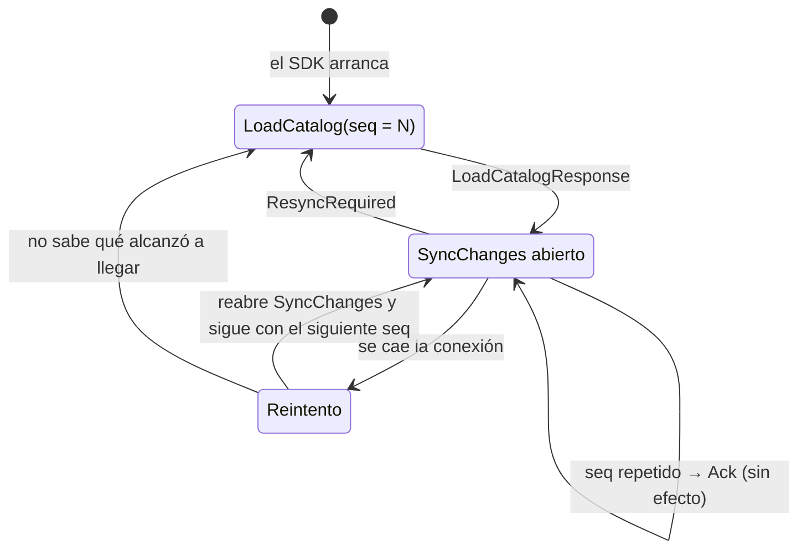

# Contrato gRPC con la institución

Cómo entra la información de la universidad al motor. Este contrato lo implementará el
[SDK](sdk.md), y hoy lo implementa el simulador
([`FakeInstitution`](../simulation/src/main/java/sched/simulation/FakeInstitution.java)).

- **Definición:** [`proto/src/main/proto/institution/v1/`](../proto/src/main/proto/institution/v1/).
  Los `.proto` son la fuente de verdad; este documento explica cómo usarlos.
- **Dónde escucha:** la instancia con rol `ingest` o `all`, en `SCHED_GRPC_PORT` (por defecto
  `50051`). El puerto se abre solo cuando la réplica local está al día con el historial.
- **Sentido:** siempre de la institución hacia el motor. El motor nunca llama a la institución
  ([ADR 0002](adr/0002-roles-de-la-institucion.md)).
- **Seguridad:** hoy sin TLS ni autenticación (`plaintext`). Pendiente antes de producción.

> `engine/v1/catalog_log.proto` es un contrato **interno** entre instancias del motor (el
> historial en NATS). La institución no lo usa.

## Servicios

| Servicio | RPC | Tipo | Para qué |
|---|---|---|---|
| `CatalogService` | `LoadCatalog(stream CatalogChunk) → LoadCatalogResponse` | streaming del cliente | Carga completa del catálogo |
| `CatalogEventsService` | `SyncChanges(stream CatalogEvent) → stream SyncStatus` | bidireccional | Cambios incrementales, con un acuse por evento |

### Datos

Un **grupo** (`Section`) es la unidad del catálogo:

| Campo | Descripción |
|---|---|
| `section_id` | Identificador único del grupo, por ejemplo `MAT101-01`. Obligatorio |
| `course_id` | Curso al que pertenece. Obligatorio |
| `slots` | Franjas semanales: `day` (`WEEKDAY_MONDAY` … `WEEKDAY_SUNDAY`), `start_minute` y `end_minute` en minutos desde la medianoche, con `0 ≤ inicio < fin ≤ 1440` |
| `capacity` | Cupo total |
| `available_seats` | Cupo disponible ahora. Con 0 el grupo no se ofrece a los estudiantes |

## El número de secuencia `seq`

Todo lo que envía la institución lleva un `seq`, y es lo que permite al motor detectar si se
perdió algo ([ADR 0003](adr/0003-replica-del-catalogo.md)).

- **Lo asigna la institución** (es decir, el SDK) y debe crecer de uno en uno con cada cambio.
- Una **carga completa** fija el punto de partida: todos sus bloques llevan el mismo `seq`, y el
  primer cambio posterior debe llevar `seq + 1`. La carga se acepta con cualquier `seq`, incluso
  menor al actual, y reemplaza todo el catálogo.
- Cada **cambio** se aplica solo si su `seq` es exactamente el último aceptado más uno.
- Cada respuesta al estudiante incluye el `seq` con que se calculó (`catalog_seq`).

## Flujo



### 1. Carga completa: `LoadCatalog`

El cliente envía el catálogo en uno o varios bloques (`CatalogChunk`) y luego cierra el stream.
El motor responde una sola vez:

```json
{ "seq": "10", "sections_loaded": 2 }
```

| Error gRPC | Cuándo |
|---|---|
| `INVALID_ARGUMENT` | Bloques con `seq` distinto, un grupo sin `section_id` o `course_id`, una franja inválida o una carga vacía. **La carga completa se descarta** |
| `INTERNAL` | No se pudo escribir en el historial, por ejemplo porque NATS no está disponible |

Partir en bloques evita mensajes enormes. Un tamaño razonable es de unos cientos de grupos por
bloque.

Se usa al conectarse por primera vez, cada vez que el motor responde `ResyncRequired` y, si se
quiere, periódicamente como red de seguridad.

### 2. Cambios: `SyncChanges`

Stream bidireccional que el SDK mantiene **abierto** mientras corre. Por cada `CatalogEvent` el
motor responde un `SyncStatus`, en el mismo orden.

| Cambio | Cuándo enviarlo |
|---|---|
| `seats_changed { section_id, available_seats }` | Cambió el cupo disponible de un grupo |
| `section_upserted { section }` | Grupo nuevo, o cambió su horario o su cupo total. Reemplaza el grupo entero |
| `section_removed { section_id }` | Se cerró o canceló el grupo |

Respuestas posibles:

| Respuesta | Significado | Qué debe hacer el SDK |
|---|---|---|
| `ack { seq }` | Aplicado, o ya estaba aplicado si el `seq` era repetido | Avanzar al siguiente |
| `resync_required { expected_seq, received_seq }` | Hay un hueco: se esperaba `expected_seq`. Con `expected_seq = 0`, el motor no tiene catálogo | Hacer una carga completa |
| `rejected { seq, reason }` | Datos inválidos, por ejemplo una franja con fin antes del inicio | Registrar el error. El `seq` **no se consume**: hay que corregir el dato y reenviar ese mismo `seq`, o hacer una carga completa |

Detalles a tener en cuenta:

- **Idempotencia:** reenviar un `seq` ya aceptado responde `ack` y no cambia nada. Ante la duda
  tras una reconexión, el SDK puede reenviar lo último sin riesgo.
- **Grupo desconocido:** `seats_changed` sobre un grupo que el motor no tiene responde `ack` y
  avanza el `seq`, pero no crea el grupo, porque no tiene sus datos. Para un grupo nuevo se usa
  `section_upserted`.
- **Cerrar el stream** marca todas las réplicas como desactualizadas (`stale = true` en las
  respuestas a estudiantes) hasta que llega el siguiente `seq` o una carga completa. Por eso el
  SDK debe mantenerlo abierto y reconectarse rápido si se cae.
- **Tras un hueco**, la ingesta rechaza todo cambio con `resync_required` hasta recibir una carga
  completa.

### Ejemplo de una sesión

```
LoadCatalog(seq=10, 2 grupos)                → seq=10 sections_loaded=2
SyncChanges:
  seq=11 seats_changed MAT101-01 → 11        → ack 11
  seq=11 seats_changed MAT101-01 → 11        → ack 11            (repetido: sin efecto)
  seq=12 section_removed FIS101-01           → ack 12
  seq=15 seats_changed MAT101-01 → 3         → resync_required esperado=13 recibido=15
LoadCatalog(seq=15, …)                       → vuelve a estar sincronizado
```

## Probar el contrato a mano

La ingesta tiene **gRPC Server Reflection** habilitado, así que las herramientas descubren los
servicios y mensajes sin necesidad de los `.proto`. Los ejemplos usan las imágenes de Docker
para no tener que instalar nada; `--network host` permite llegar a `localhost:50051`.

Primero levanta el motor ([inicio-rapido.md](inicio-rapido.md), camino B o C).

### grpcui: interfaz web

```sh
docker run --rm --network host fullstorydev/grpcui -plaintext -port 8081 localhost:50051
```

Abre <http://localhost:8081>. Ahí puedes elegir el servicio y el método, llenar el mensaje en un
formulario y ver la respuesta, como en Swagger UI.

### grpcurl: línea de comandos

```sh
G="docker run --rm -i --network host fullstorydev/grpcurl -plaintext"

# Qué servicios hay y cómo son
$G localhost:50051 list
$G localhost:50051 describe institution.v1.CatalogEventsService
$G localhost:50051 describe institution.v1.Section

# Carga completa en dos bloques (cada objeto JSON es un mensaje del stream)
$G -d @ localhost:50051 institution.v1.CatalogService/LoadCatalog <<'EOF'
{"seq": 10, "sections": [
  {"section_id": "MAT101-01", "course_id": "MAT101", "capacity": 35, "available_seats": 12,
   "slots": [{"day": "WEEKDAY_MONDAY", "start_minute": 360, "end_minute": 480}]}
]}
{"seq": 10, "sections": [
  {"section_id": "FIS101-01", "course_id": "FIS101", "capacity": 30, "available_seats": 5,
   "slots": [{"day": "WEEKDAY_TUESDAY", "start_minute": 420, "end_minute": 540}]}
]}
EOF

# Cambios
$G -d @ localhost:50051 institution.v1.CatalogEventsService/SyncChanges <<'EOF'
{"seq": 11, "seats_changed": {"section_id": "MAT101-01", "available_seats": 11}}
{"seq": 12, "section_removed": {"section_id": "FIS101-01"}}
EOF
```

En JSON, los campos `uint64` como `seq` llegan entre comillas (`"seq": "11"`); es la
representación estándar de protobuf.

### Postman

Postman también soporta gRPC: *New → gRPC*, URL `localhost:50051` y, en *Service definition*,
*Use server reflection*.

## Generar un cliente en otro lenguaje

Con `protoc` o [`buf`](https://buf.build) se generan clientes desde
`proto/src/main/proto/institution/v1/` para cualquier lenguaje que soporte gRPC (Python, C#,
Go, Node.js, PHP…). Es útil para pruebas o integraciones puntuales; la vía prevista para las
universidades es el [SDK](sdk.md).
