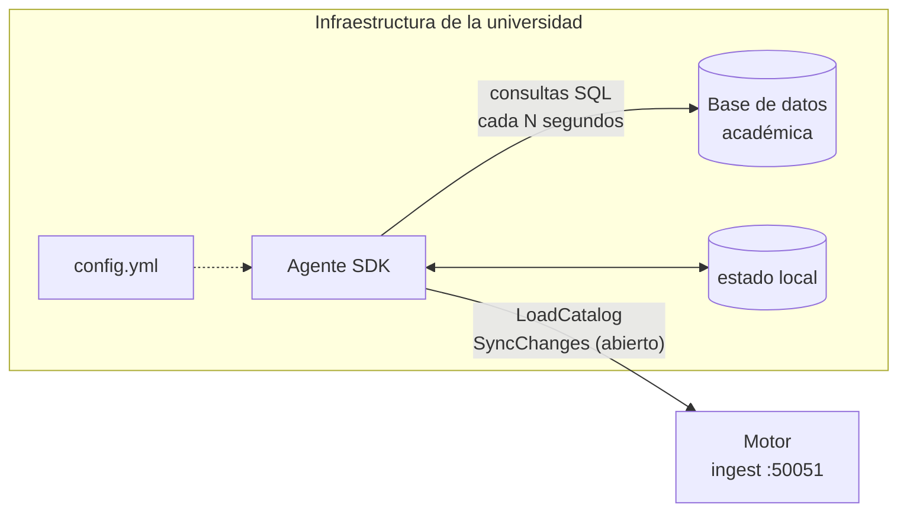
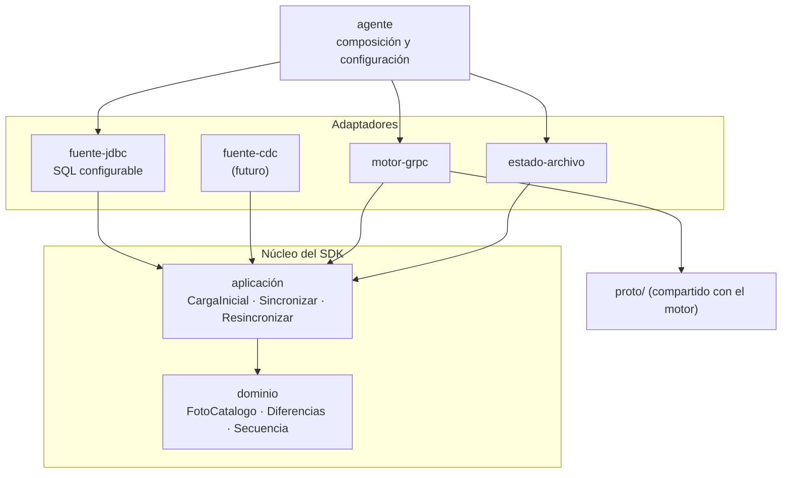

# SDK de integración (diseño propuesto)

> **Estado: propuesta.** El SDK todavía no existe. Este documento recoge el diseño del
> [ADR 0007](adr/0007-sdk-de-integracion-propio.md) para que el equipo lo discuta y lo
> implemente. Los nombres, el formato de configuración y los ejemplos son ilustrativos.

## Qué es

Un **agente** que cada universidad instala en su infraestructura. Lee el sistema académico,
detecta los cambios de grupos y cupos, y los envía al motor en tiempo real por el
[contrato gRPC](contrato-institucion.md). La universidad lo **configura**; no escribe código.



Hoy el papel del agente lo cumple, de forma mínima, el simulador:
[`FakeInstitution`](../simulation/src/main/java/sched/simulation/FakeInstitution.java) muestra
cómo abrir los dos RPC con grpc-java y es un buen punto de partida para el adaptador `Motor`.

## Responsabilidades

1. **Carga inicial.** Al arrancar, leer el catálogo completo y enviarlo con `LoadCatalog`.
2. **Detectar cambios.** Cada pocos segundos, volver a leer y comparar con la foto anterior.
3. **Traducir diferencias a eventos**, numerándolos con `seq` consecutivos.
4. **Enviarlos** por un `SyncChanges` que se mantiene abierto, y procesar cada respuesta.
5. **Recuperarse:** reconectarse si se cae el canal y hacer una carga completa cuando el motor
   lo pida.
6. **Ser observable:** logs claros, y métricas como el último `seq` confirmado, el retraso y los
   errores, para que la universidad sepa si la sincronización está sana.

## Arquitectura hexagonal del SDK

El SDK es un **hexágono propio**: no depende de los módulos del motor, solo de `proto/`.



Estructura sugerida si se implementa en Java (ver "Lenguaje" en el ADR 0007):

```
sdk/
  domain/              FotoCatalogo, Grupo, Diferencias (calcula eventos), Secuencia
  application/         casos de uso y puertos
  adapters/
    source-jdbc/       FuenteAcademica con consultas SQL configurables
    engine-grpc/       Motor sobre grpc-java (usa proto/)
    state-file/        EstadoLocal en un archivo
  agent/               main, lectura de configuración y composición
```

### Puertos

```java
/** Lo que la universidad tiene ahora. */
interface FuenteAcademica {
    FotoCatalogo leer() throws FuenteNoDisponible;
}

/** El motor, visto desde el SDK. */
interface Motor {
    void cargar(long seq, FotoCatalogo foto);       // LoadCatalog
    CanalDeCambios abrirCambios();                  // SyncChanges
}

interface CanalDeCambios extends AutoCloseable {
    RespuestaMotor enviar(long seq, Cambio cambio); // Ack | ResyncRequired | Rejected
}

/** Sobrevive a reinicios del agente. */
interface EstadoLocal {
    Optional<Estado> leer();                        // último seq confirmado y foto
    void guardar(Estado estado);
}
```

### Dominio: de dos fotos a eventos

`Diferencias.entre(anterior, actual)` compara por `section_id`:

| Situación | Evento |
|---|---|
| Está en `actual` y no en `anterior` | `section_upserted` |
| Está en `anterior` y no en `actual` | `section_removed` |
| Solo cambió el cupo disponible | `seats_changed` |
| Cambió el horario, el curso o el cupo total | `section_upserted` |
| Igual | nada |

Es lógica pura y sin dependencias: la parte más fácil de probar y la más importante de tener
bien probada.

## Ciclo de sincronización

```
arrancar:
    foto ← fuente.leer()
    seq  ← (estado.leer().seq + 1) o 1
    motor.cargar(seq, foto)                  # siempre carga completa al arrancar
    guardar(seq, foto)

repetir cada intervalo:
    actual ← fuente.leer()
    para cada cambio en Diferencias.entre(foto, actual):
        seq ← seq + 1
        según canal.enviar(seq, cambio):
            Ack             → seguir
            ResyncRequired  → ir a "resincronizar"
            Rejected        → registrar el error y resincronizar (el seq no se consumió)
    foto ← actual
    guardar(seq, foto)

si se cae el canal:
    reconectar con espera creciente (1 s, 2 s, 4 s… hasta un tope)
    reenviar desde el último cambio sin Ack (el motor ignora los repetidos)

resincronizar:
    seq ← seq + 1
    motor.cargar(seq, fuente.leer())
```

Decisiones que simplifican:

- **Carga completa al arrancar, siempre.** El motor la acepta con cualquier `seq`, así que el
  agente no necesita recordar nada para empezar bien. `EstadoLocal` solo sirve para que el `seq`
  siga creciendo entre reinicios y facilitar el diagnóstico.
- **Ante cualquier duda, carga completa.** Es la operación segura: reemplaza todo el catálogo.
- **Reenviar es seguro:** un `seq` repetido responde `Ack` sin efecto.
- **Validar antes de enviar.** El motor descarta una carga completa entera si un solo grupo es
  inválido (sin identificador, o con una franja fuera de `0 ≤ inicio < fin ≤ 1440`). El agente
  debe aplicar las mismas reglas al leer la fuente, dejar fuera los grupos inválidos y
  reportarlos. Si no, un dato malo en la base de la universidad bloquearía toda la
  sincronización.

## Configuración (ejemplo ilustrativo)

```yaml
motor:
  url: motor.ejemplo.edu.co:50051
  # tls: …                          # pendiente (ADR 0007)

fuente:
  tipo: jdbc
  url: jdbc:postgresql://bd-academica:5432/matricula
  usuario: lector_motor             # usuario de solo lectura
  clave: ${SDK_DB_PASSWORD}
  intervalo: 3s
  # La consulta debe devolver una fila por franja con estas columnas exactas.
  grupos: |
    SELECT g.codigo        AS section_id,
           g.curso         AS course_id,
           g.cupo_total    AS capacity,
           g.cupo_libre    AS available_seats,
           h.dia           AS day,            -- 1 = lunes … 7 = domingo
           h.hora_inicio   AS start_time,     -- HH:MM
           h.hora_fin      AS end_time
    FROM grupos g JOIN horarios h ON h.grupo = g.codigo
    WHERE g.periodo = '2027-1'

estado:
  archivo: /var/lib/sched-sdk/estado.json
```

Lo único que adapta cada universidad es la consulta: cómo se llaman sus tablas y columnas.

## Cómo probarlo

| Nivel | Qué se prueba | Cómo |
|---|---|---|
| Dominio | `Diferencias` y numeración de `seq` | Pruebas unitarias puras |
| Aplicación | Ciclo de sincronización, resync y reconexión | Con puertos falsos en memoria |
| `source-jdbc` | Lectura y mapeo de columnas | Base de datos en contenedor (Testcontainers) |
| Extremo a extremo | Agente contra el motor real | `deploy/docker-compose.yml` + una base de datos de ejemplo; verificar con `POST /combinations` que los cambios llegan |

## Fases sugeridas

1. **Núcleo:** dominio y aplicación con puertos falsos y pruebas.
2. **Adaptadores mínimos:** `engine-grpc`, `source-jdbc` (PostgreSQL) y `state-file`; prueba
   extremo a extremo en Docker Compose.
3. **Distribución:** imagen de Docker, documentación de instalación para universidades y una
   base de datos de ejemplo.
4. **Producción:** TLS y autenticación ante el motor, métricas y más bases de datos.
5. **Menor latencia:** adaptador CDC o por eventos.
